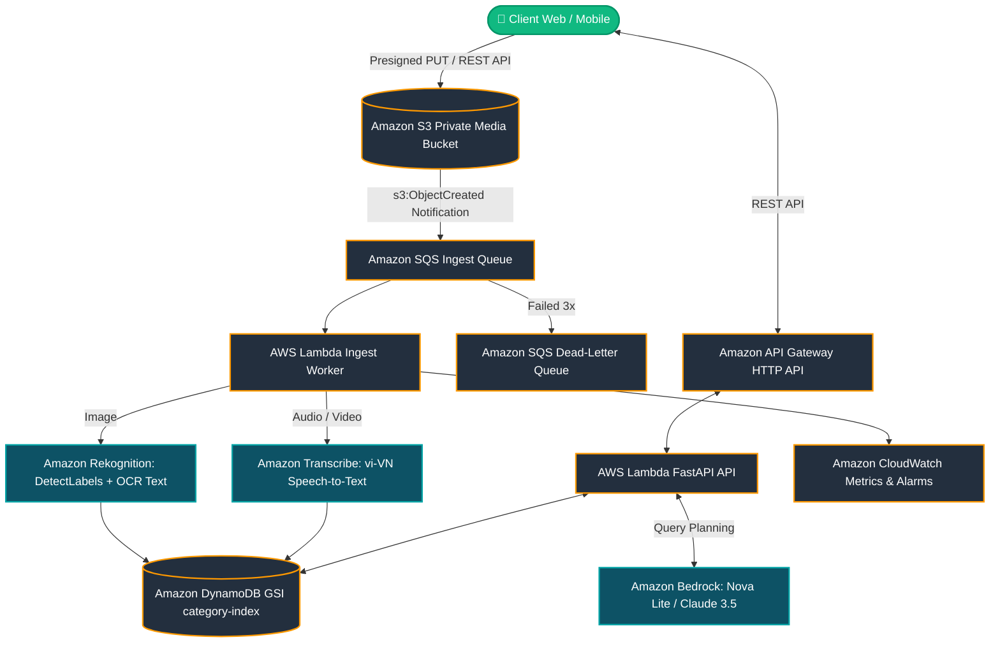

# AgentSys: Serverless Multi-Modal Media Search on AWS

[](https://aws.amazon.com/serverless/sam/)
[](https://www.python.org/)
[](https://fastapi.tiangolo.com/)
[](https://react.dev/)
[](tests/)
[](LICENSE)

> **Dự án Thực tập FCAJ (AWS First Cloud AI Journey)**  
> Hệ thống tìm kiếm và truy vấn Media đa mô thức (Hình ảnh, Âm thanh bài giảng, Video) bằng ngôn ngữ tự nhiên tiếng Việt xây dựng trên nền tảng **AWS Serverless & Amazon Bedrock GenAI**.

---

## 🏛️ Kiến trúc Hệ thống (Architecture Overview)



---

## ☁️ 10 Dịch vụ AWS Cốt lõi (Integrated Services)

| STT | Dịch vụ AWS | Vai trò trong hệ thống |
| :---: | :--- | :--- |
| **1** | **Amazon S3** | Lưu trữ tệp media bảo mật với SSE-S3 encryption, presigned URL và S3 ObjectCreated events. |
| **2** | **Amazon SQS + DLQ** | Hàng đợi đệm phân tán chống nghẽn; Dead-Letter Queue tự động cô lập tệp lỗi sau 3 lần retry. |
| **3** | **AWS Lambda** | Điện toán Serverless thực thi `ApiFunction` (FastAPI + Mangum) và `IngestWorkerFunction`. |
| **4** | **Amazon Rekognition** | Nhận diện vật thể (`DetectLabels`) và bóc toàn bộ chữ viết tay/in ấn (`DetectText` OCR). |
| **5** | **Amazon Transcribe** | Chuyển đổi giọng nói bài giảng tiếng Việt (`vi-VN`) thành văn bản có dấu. |
| **6** | **Amazon Bedrock** | GenAI Query Planner chuyển câu hỏi tiếng Việt tự nhiên thành kế hoạch tìm kiếm chính xác. |
| **7** | **Amazon DynamoDB** | NoSQL Database On-Demand, Global Secondary Index `category-index` tra cứu dưới 10ms. |
| **8** | **Amazon CloudWatch** | Giám sát toàn diện: Custom Metrics (`MediaIngested`), Logs và 3 chuông cảnh báo Alarms. |
| **9** | **AWS IAM** | Quản lý bảo mật chuẩn Least-Privilege cho từng hàm Lambda (không dùng Access Key tĩnh). |
| **10** | **AWS SAM (IaC)** | Đóng gói toàn bộ hạ tầng trong `infra/template.yaml`, triển khai 1-click tự động. |

---

## 🚀 Hướng dẫn Chạy Thử nghiệm (Local Quickstart)

### 1. Khởi động nhanh (1-Click Launcher):
Nhấp đúp chuột vào file `start_app.bat` trên Windows để tự động bật cả Backend, Frontend và mở trình duyệt.

### 2. Khởi động thủ công:

**Terminal 1 — Backend API:**
```bash
# Cài đặt thư viện
pip install -r requirements.txt

# Chạy FastAPI server
python -m uvicorn apps.api.main:app --port 8000 --reload
```

**Terminal 2 — Frontend Gallery UI:**
```bash
cd gallery_web
npm install
npm run dev
```

* **Giao diện Web:** `http://localhost:5174`
* **Swagger API Docs:** `http://localhost:8000/docs`
* **Health Check:** `http://localhost:8000/health`

---

## 🧪 Kiểm thử Tự động (Automated Testing)

Chạy bộ kiểm thử 21 test cases toàn diện (Unit tests, Ingest Events, Search & NLP Resilience, SAM Template & Security):

```bash
pytest tests/ -v
```

Kiểm tra hợp lệ trước khi nộp bài:
```bash
python scripts/verify_local.py
```

---

## 🚢 Triển khai lên AWS (Cloud Deployment)

```bash
# 1. Build SAM Application
sam build -t infra/template.yaml

# 2. Deploy lên AWS
sam deploy --guided --capabilities CAPABILITY_IAM
```

Sau khi hoàn tất đánh giá, xóa tài nguyên để tránh phát sinh chi phí:
```bash
sam delete --stack-name agentsys
```

---

## 👨‍💻 Tác giả & Đồ án
* **Sinh viên thực hiện:** Đỗ Trần Minh Phúc (HCMUS)
* **Chương trình:** First Cloud AI Journey (FCAJ) — AWS Vietnam
