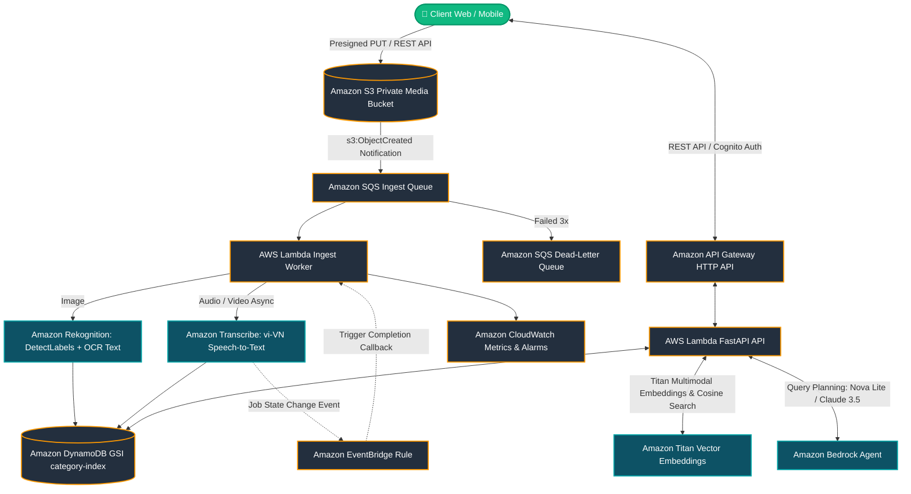

# Serverless Multi-Modal Agent

[](https://aws.amazon.com/serverless/sam/)
[](https://www.python.org/)
[](https://fastapi.tiangolo.com/)
[](https://react.dev/)
[](tests/)
[](LICENSE)

> **Event-driven multimodal media intelligence and semantic retrieval platform built on AWS Serverless, Amazon Bedrock Generative AI, and Vector Embeddings.**

---

## 🏛️ Architecture Overview



---

## ☁️ Integrated AWS Services

| Service | Architecture Role |
| :--- | :--- |
| **Amazon S3** | Encrypted private media storage with SSE-S3, Presigned URLs, and ObjectCreated event triggers. |
| **Amazon SQS + DLQ** | Decoupled event-driven buffer with Dead-Letter Queue isolation after 3 failed retries. |
| **AWS Lambda** | Serverless compute executing FastAPI REST endpoints (`ApiFunction`) and background worker (`IngestWorkerFunction`). |
| **Amazon Rekognition** | Computer vision label classification (`DetectLabels`) and OCR text extraction (`DetectText`). |
| **Amazon Transcribe** | Speech-to-text pipeline transcribing Vietnamese audio lectures (`vi-VN`) into indexed text. |
| **Amazon Bedrock** | Generative AI query planning (Nova Lite / Claude 3.5 Sonnet) translating natural queries into structured search plans. |
| **Amazon DynamoDB** | On-demand NoSQL document store with sub-10ms GSI queries (`category-index`). |
| **Amazon CloudWatch** | End-to-end observability: Custom metric telemetry (`MediaIngested`), structured logs, and automated alarms. |
| **AWS IAM** | Granular least-privilege role policies scoped per Lambda function (no static credentials). |
| **AWS SAM** | Infrastructure as Code (IaC) automating multi-service cloud provisioning via declarative templates. |

---

## 🚀 Quickstart & Local Testing

### 1. Launch Everything (1-Click on Windows):
Double-click `start_app.bat` to launch the FastAPI backend, React frontend, and open your browser automatically.

### 2. Manual Start:

**Backend API:**
```bash
pip install -r requirements.txt
python -m uvicorn apps.api.main:app --port 8000 --reload
```

**Frontend UI:**
```bash
cd gallery_web
npm install
npm run dev
```

* **Web Application:** `http://localhost:5174` (or mobile on LAN: `http://<LAN_IP>:5174`)
* **API Documentation:** `http://localhost:8000/docs`
* **Health Endpoint:** `http://localhost:8000/health`

---

## 🧪 Automated Testing & Verification

Run the full test suite (21 unit tests, ingest event simulation, search resilience, and SAM template validation):

```bash
pytest tests/ -v
```

Pre-flight compliance check:
```bash
python scripts/verify_local.py
```

---

## 🚢 Cloud Deployment (AWS SAM)

```bash
# 1. Build serverless artifacts
sam build -t infra/template.yaml

# 2. Deploy to AWS
sam deploy --guided --capabilities CAPABILITY_IAM
```

Tear down resources after evaluation:
```bash
sam delete --stack-name agentsys
```

---

## 👨‍💻 Author & Program
* **Author:** Đỗ Trần Minh Phúc (HCMUS)
* **Program:** First Cloud AI Journey (FCAJ) — AWS Vietnam
