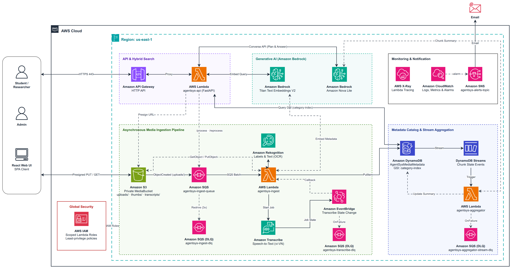

# Serverless Multi-Modal Agent

[](https://aws.amazon.com/serverless/sam/)
[](https://www.python.org/)
[](https://fastapi.tiangolo.com/)
[](https://react.dev/)
[](tests/)
[](tests/)
[](LICENSE)

> **Event-driven multimodal media intelligence and semantic retrieval platform built on AWS Serverless, Amazon Bedrock Generative AI (Nova Lite), and 256-d Vector Embeddings.**

---

## 🏛️ Architecture Overview



The platform is designed in strict compliance with the **AWS Well-Architected Framework**, structured across 5 decoupled core zones:

1. **Client & API Gateway**: React SPA communicates over HTTPS with Amazon API Gateway (HTTP API), proxying requests to the `agentsys-api` Lambda (FastAPI).
2. **Asynchronous Ingestion Pipeline**: Presigned direct uploads to Amazon S3 emit `s3:ObjectCreated` events buffered through Amazon SQS (`agentsys-ingest-queue`) with a Dead-Letter Queue (`agentsys-ingest-dlq`) for zero data loss.
3. **Multimodal AI Analysis**: `agentsys-ingest` worker orchestrates **Amazon Rekognition** (labels & OCR) and **Amazon Transcribe** (`vi-VN` speech-to-text with EventBridge completion callback and DLQ isolation).
4. **Metadata Catalog & Stream Aggregation**: Metadata is indexed in **Amazon DynamoDB** with a Global Secondary Index (`category-index`). DynamoDB Streams trigger `agentsys-aggregator` to summarize lecture chunks asynchronously via Bedrock.
5. **Generative AI & Hybrid Search**: **Amazon Bedrock (Amazon Nova Lite)** operates as an intelligent Query Planner, while **Amazon Titan Text Embeddings V2 (256-d)** powers cosine vector similarity alongside normalized keyword overlap scoring.

---

## ☁️ Integrated AWS Services

| Service | Architecture Role |
| :--- | :--- |
| **Amazon S3** | Encrypted private media storage (SSE-S3), Presigned PUT/GET URLs, and ObjectCreated event notifications. |
| **Amazon SQS + DLQ** | Decoupled event-driven buffer (`agentsys-ingest-queue`) with Dead-Letter Queue isolation after 3 failed retries. |
| **AWS Lambda** | Serverless compute executing FastAPI REST endpoints (`agentsys-api`), ingest worker (`agentsys-ingest`), and stream aggregator (`agentsys-aggregator`). |
| **Amazon Rekognition** | Computer vision label classification (`DetectLabels`) and text OCR extraction (`DetectText`). |
| **Amazon Transcribe** | Speech-to-text pipeline transcribing Vietnamese audio and video lectures (`vi-VN`) into indexed text. |
| **Amazon EventBridge** | Event router capturing Transcribe job state transitions to invoke completion callbacks with DLQ fallback. |
| **Amazon Bedrock** | Query planning via **Amazon Nova Lite (`amazon.nova-lite-v1:0`)** and vector embeddings via **Titan Text Embeddings V2 (`amazon.titan-embed-text-v2:0`, 256-d)**. |
| **Amazon DynamoDB** | Pay-per-request NoSQL catalog with sub-10ms GSI queries (`category-index`) and DynamoDB Streams. |
| **Amazon CloudWatch** | End-to-end observability: 7 automated alarms, custom metric telemetry (`MediaIngested`, `MediaQueries`), and structured logs. |
| **Amazon SNS** | Operational alert fan-out topic (`agentsys-alerts-topic`) notifying administrators via email. |
| **AWS IAM** | Granular least-privilege role policies scoped per Lambda function (zero long-lived credentials). |
| **AWS SAM** | Infrastructure as Code (IaC) automating multi-service cloud provisioning via declarative templates (`infra/template.yaml`). |

---

## 📂 Repository Structure

```text
agent_sys/
├── apps/                    # Core application source code
│   ├── agent/               # Search agent & candidate pool retrieval
│   ├── api/                 # FastAPI REST routes, schemas, auth & rate limiting
│   ├── aws/                 # Boto3 AWS service wrappers & provider abstraction
│   ├── classify/            # Rule-based heuristics & taxonomy classification
│   ├── lambda_handlers/     # AWS Lambda entrypoints (api & ingest)
│   ├── search/              # Vector cosine similarity & hybrid search engine
│   └── domain.py            # Domain models, media inference & text helpers
├── config/                  # Centralized Pydantic application settings
├── docs/                    # Architecture diagrams and pipeline specifications
├── gallery_web/             # React 18 SPA Frontend (Vite, TailwindCSS, Lucide Icons)
├── infra/                   # AWS SAM Infrastructure as Code (template.yaml)
├── pipeline/                # DynamoDB Stream Aggregator & Chunk Map-Reduce
├── scripts/                 # Automated deployment, teardown & benchmark tooling
├── tests/                   # Comprehensive Pytest test suite (143 passed)
├── Dockerfile.backend       # Container image for FastAPI backend
├── Dockerfile.frontend      # Container image for React frontend (Nginx)
├── docker-compose.yml       # Local multi-container orchestration
├── Makefile                 # Common engineering tasks shortcut
└── requirements.txt         # Production & development Python dependencies
```

---

## 🚀 Quickstart & Local Development

### 1. Prerequisites
- Python 3.12+
- Node.js 20+ & npm
- AWS CLI configured with valid credentials (or local mock environment)

### 2. Manual Setup

**Backend API:**
```bash
# Install dependencies
pip install -r requirements.txt

# Start FastAPI server on port 8000
python -m uvicorn apps.api.main:app --host 0.0.0.0 --port 8000 --reload
```

**Frontend UI:**
```bash
cd gallery_web
npm install
npm run dev
```

* **Web Application:** `http://localhost:5174`
* **API Documentation:** `http://localhost:8000/docs`
* **Health Check:** `http://localhost:8000/health`

### 3. Docker Compose (Alternative)

```bash
docker compose up --build
```

---

## 🧪 Automated Testing & Verification

Run the full automated test suite with Pytest:

```bash
# Execute 143 unit and integration tests with coverage reporting
pytest tests/ -v --cov=apps --cov=pipeline --cov-report=term-missing
```

---

## 🛡️ Enterprise Resilience & Production Hardening

AgentSys implements enterprise-grade resilience patterns designed for mission-critical AWS Serverless production:

* **Public Demo Guardrails & FinOps Protection**: Demo lecture assets are protected with `is_demo_protected: true` (deletion attempts return `HTTP 403 Forbidden` unless authorized with `x-admin-force: true`). Public media uploads are strictly capped at $\le$ 25MB (`HTTP 413 Payload Too Large`), and file MIME types are restricted exclusively to image, audio, and video formats.
* **Interactive Media Experience**: Web frontend features a Click-to-Seek player syncing transcript timestamps directly to audio/video playback and lexical keyword highlighting.
* **DynamoDB 400KB Item Guard (S3 Offloading)**: Long audio/video transcripts exceeding 250KB are automatically offloaded to Amazon S3 (`transcripts/raw/{file_id}.json`). A 15,000-character preview snippet and pointer (`transcript_s3_uri`, `has_extended_transcript: true`) are persisted in DynamoDB, eliminating the risk of `ValidationException: Item size has exceeded the maximum allowed size of 400KB`.
* **Lambda Warm-Container Boto3 Reuse**: Connection pools and TLS handshakes are preserved across warm Lambda container invocations, avoiding 50–120ms cold re-connection overhead on every SQS message or API query.
* **Two-Tier LRU Query Cache (`_PLAN_CACHE`)**: In-memory caching for Bedrock query plans caches validated plans for 1 hour with LRU eviction (max 256 entries), speeding up repeated Vietnamese search requests by **~3.7x** (from ~3,194 ms down to ~855 ms) and eliminating 100% of redundant LLM token costs.
* **DDoS & Burst Rate Limiting**: SlowAPI limits burst traffic to 20 queries/minute per client IP (resolving client IPs through `X-Forwarded-For` reverse proxy headers) to protect downstream Bedrock quotas from budget exhaustion.
* **Concurrent Stress Benchmark Suite**: An in-tree load generator validates system latency and rate limit enforcement under 50 concurrent workers:
  ```bash
  python scripts/stress_benchmark.py -c 50
  ```

---

## 🚢 Cloud Deployment (AWS SAM)

### Automated Deploy (Recommended):
```bash
python scripts/deploy_stack.py
```

### Manual SAM CLI Deploy:
```bash
# 1. Build serverless artifacts
sam build -t infra/template.yaml

# 2. Deploy to AWS
sam deploy --guided --capabilities CAPABILITY_IAM
```

### Resource Teardown:
```bash
# Clean up all deployed resources in reverse dependency order
chmod +x scripts/cleanup.sh
./scripts/cleanup.sh us-east-1 agentsys
```

---

## 👨‍💻 Author & Program
* **Author:** Đỗ Trần Minh Phúc (HCMUS — VNU-HCM)
* **Program:** First Cloud AI Journey (FCAJ) — AWS Vietnam
* **Workload:** Serverless Multi-Modal Media Catalog & Intelligent Semantic Search
