# Lecture-Transcript Summarization Pipeline Architecture (Tier 1 + Tier 2)

This document details the design, latency tiers, and architectural trade-offs of the **Lecture-Transcript Summarization Pipeline** for AgentSys.

---

## 1. Sequence Flow & 3-Phase Latency Separation

```mermaid
sequenceDiagram
    autonumber
    actor Client as 📱 Web / Mobile Client
    participant S3 as 🪣 Amazon S3
    participant Transcribe as 🎙️ Amazon Transcribe
    participant EB as ⚡ EventBridge
    participant IngestLambda as ⚙️ Ingest Worker Lambda
    participant DynamoDB as 🗄️ Amazon DynamoDB
    participant SQS as 📬 Refine SQS Queue
    participant Worker as 🤖 Chunk Refine Worker (Bedrock)
    participant Aggregator as 🧩 Aggregator Lambda (DynamoDB Streams)

    %% -------------------------------------------------------------------------
    %% PHASE 1: ASR INGESTION (Minutes)
    %% -------------------------------------------------------------------------
    rect rgb(35, 45, 65)
    Note over Client,Transcribe: ⏱️ PHASE 1: ASR Ingestion (1 - 3+ minutes, asynchronous)
    Client->>S3: Upload lecture audio (.m4a / .mp3)
    S3->>IngestLambda: S3 ObjectCreated Event
    IngestLambda->>Transcribe: StartTranscriptionJob (vi-VN)
    IngestLambda->>DynamoDB: Save record (status="INDEXING", analysis_source="transcribe-indexing")
    Transcribe-->>S3: Write transcripts/{job_name}.json (upon completion)
    Transcribe-->>EB: EventBridge: TranscriptionJobStateChange (COMPLETED)
    EB->>IngestLambda: Trigger completion handler
    end

    %% -------------------------------------------------------------------------
    %% PHASE 2: TIER 1 IMMEDIATE EXTRACTION (Milliseconds)
    %% -------------------------------------------------------------------------
    rect rgb(20, 60, 50)
    Note over IngestLambda,DynamoDB: ⚡ PHASE 2: Tier 1 Fast Extraction (~10 - 50 ms execution)
    IngestLambda->>S3: Get transcript JSON
    IngestLambda->>IngestLambda: extract_smart_summary() [Independent Announcements + Topic]
    IngestLambda->>IngestLambda: is_low_quality_line() [Filter filler density & stutters]
    IngestLambda->>IngestLambda: classify_subject_with_confidence() [Absolute threshold first]
    IngestLambda->>DynamoDB: Update record (summary=provisional, status="READY", pipeline_status="PROVISIONAL_READY")
    IngestLambda->>Client: UI reflects immediate provisional summary & confidence
    end

    %% -------------------------------------------------------------------------
    %% PHASE 3: TIER 2 MAP-REDUCE LLM REFINE (Async Background)
    %% -------------------------------------------------------------------------
    rect rgb(60, 30, 60)
    Note over IngestLambda,Aggregator: 🧠 PHASE 3: Tier 2 LLM Map-Reduce Refine (5 - 15 seconds total)
    IngestLambda->>IngestLambda: chunk_transcribe_json() [5-10 min segment breaks & silence gaps]
    IngestLambda->>DynamoDB: init_file_pipeline_state() + save_chunks_batch() [total_chunks=N, completed=0]
    IngestLambda->>SQS: Dispatch N chunk refine messages
    
    par Parallel Chunk Processing
        SQS->>Worker: Worker picks Chunk 0
        Worker->>Worker: Bedrock Nova-Lite refine Chunk 0
        Worker->>DynamoDB: mark_chunk_completed(0) [ADD chunks_completed :inc]
    and
        SQS->>Worker: Worker picks Chunk 1..N-1
        Worker->>Worker: Bedrock Nova-Lite refine Chunk 1..N-1
        Worker->>DynamoDB: mark_chunk_completed(k) [ADD chunks_completed :inc]
    end

    DynamoDB-->>Aggregator: DynamoDB Streams (chunks_completed == total_chunks)
    Aggregator->>DynamoDB: get_file_chunks() [Sorted strictly by chunk_index 0..N-1]
    Aggregator->>Aggregator: reduce_and_finalize() [Stitch chronological summary]
    Aggregator->>DynamoDB: Update parent (summary=refined_summary, pipeline_status="REFINED_COMPLETED")
    Aggregator->>Client: Final refined lecture intelligence available
    end
```



---

## 2. Architectural Design Decisions & Trade-Offs

### A. Atomic Counter vs. Application-Level Read-Modify-Write
* **Problem**: In a distributed serverless environment, multiple workers process distinct chunks in parallel. If worker A and worker B read `chunks_completed = 2` simultaneously, both compute `3`, and write it back, a lost update occurs (`chunks_completed` becomes 3 instead of 4).
* **Solution**: We use DynamoDB's native **Atomic Update Expression**:
  ```python
  UpdateExpression="ADD chunks_completed :inc SET updated_at = :now"
  ExpressionAttributeValues={":inc": 1, ":now": ...}
  ```
  DynamoDB serializes the increment at the database partition level. No application locks or distributed mutexes are needed, guaranteeing zero race conditions.

### B. Segment/Silence-Based Chunking vs. Fixed-Time Slicing
* **Fixed-Time Slicing (e.g. strict cut at 10:00.00)**:
  - Often cuts in the middle of a word or sentence (e.g. `"Thuật toán Round..."` in chunk 1 and `"...Robin giúp giảm latency"` in chunk 2).
  - Destroys semantic coherence for the LLM prompt.
* **Segment/Silence-Aware Chunking (Our Design)**:
  - Slices at natural sentence terminators (`.`, `?`, `!`) or pauses with silence $\ge 1.2\text{s}$ extracted from Amazon Transcribe item timestamps.
  - Keeps sentence context 100% intact while targeting a 5–10 minute token-efficient context window for Amazon Bedrock Nova Lite.

### C. Independent Channels for Announcements vs. Topic Summary
* **Legacy Flaw**: Used `if has_admin: return admin elif: return topic`, which completely dropped technical topics whenever a lecturer mentioned an exam date.
* **Refined Design**: Two independent pipelines:
  1. `announcements`: Extracts administrative milestones (deadlines, exam dates, presentation lengths, grading dates).
  2. `topic_summary`: Evaluates non-administrative sentences with `is_low_quality_line` filtering out conversational filler density and ASR stuttering.
  3. `topic_confidence`: Flags whether the provisional overview is `"LOW"` or `"MEDIUM"` for UI trust transparency.

### D. Absolute Threshold Before Margin in Subject Classification
* **Legacy Flaw**: If only one candidate matched with a tiny score (e.g. score = 2), margin calculation evaluated it as 100% margin over 0 and erroneously declared high confidence.
* **Refined Design**: `classify_subject_with_confidence` enforces `min_absolute_threshold` (e.g. 12) strictly **before** considering the margin:
  ```python
  if top_score < min_absolute_threshold:
      return top_subject, False
  ```

---

## 3. Resilience & Failure Isolation

| Scenario | System Behavior |
| :--- | :--- |
| **Worker Bedrock Rate-Limit / Throttling** | Chunk status marked `FAILED`, message returned to SQS with Exponential Backoff (visibility timeout increases). Does not block sibling chunks. |
| **Out-of-Order Worker Completion** | Aggregator does NOT concatenate in arrival order. It executes `get_file_chunks()`, sorting strictly by `chunk_index` (`0, 1, ..., N-1`). |
| **Transcribe Private S3 403** | Resolved via authenticated boto3 S3 `get_object` instead of raw unauthenticated `urllib`. |
