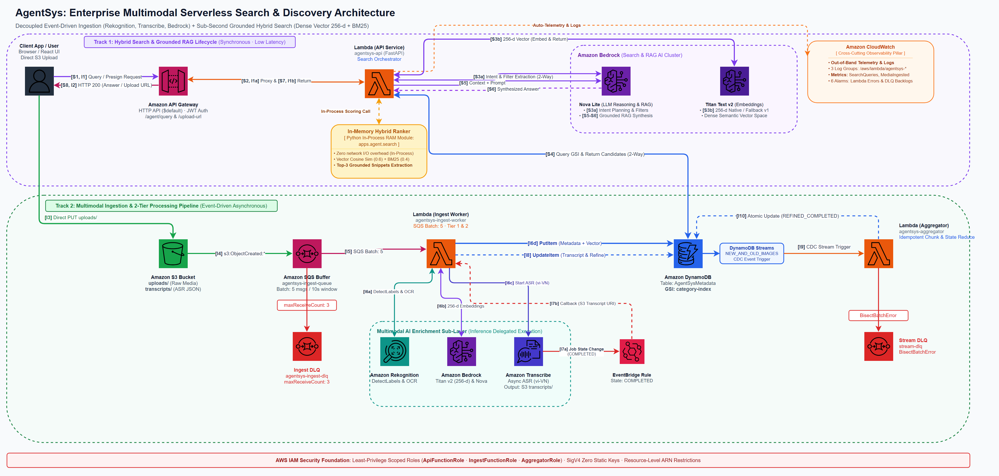

# Project Proposal: AgentSys — Multi-modal Media Retrieval & Cataloging System on AWS

**Student:** Do Tran Minh Phuc · VNU-HCM University of Science (HCMUS)  
**Internship Period:** 12/08/2026 – 12/11/2026 · Amazon Web Services Vietnam LLC (FCAJ Bootcamp)

---

## 1. Executive Summary

**AgentSys** is an intelligent, multi-modal media cataloging and retrieval platform engineered entirely on a **Serverless** and **Generative AI** architecture using **Amazon Web Services (AWS)**.

The system addresses the fundamental limitation of traditional camera-roll search by automatically extracting multi-sensory semantics from images, audio, and video files:
* **Amazon S3**: Secure object storage with Block Public Access and SSE-S3 encryption.
* **Amazon SQS & Dead-Letter Queue (DLQ)**: Ingestion buffer ensuring resilient asynchronous processing with zero data loss.
* **AWS Lambda & Managed AI**: Orchestrating **Amazon Rekognition** (detecting objects, scenes, and Vietnamese OCR) and **Amazon Transcribe** (high-accuracy Vietnamese speech-to-text *vi-VN*).
* **Amazon Bedrock (Amazon Titan & Nova Lite)**: Serves as an AI Planner and Vector Engine converting natural language queries into optimized search plans.
* **Amazon DynamoDB**: Stores media metadata with Global Secondary Indexes (**GSI `category-index`**) enabling hybrid lexical and semantic vector search.
* **Amazon CloudWatch**: End-to-end observability with custom metrics, structured log streams, and automated alarm systems.

---

## 2. Problem Statement

In academic and professional environments, students and researchers accumulate thousands of multimodal files: whiteboard notes, lecture slide snapshots, multi-hour voice recordings, and video demos.

### Major Inefficiencies in Existing Solutions:
1. **Filename-based Search Failure**: Mobile uploads default to non-descriptive names (e.g., `IMG_20260826_104212.jpg` or `Voice_001.m4a`), providing zero semantic metadata.
2. **Costly Commercial DAM Solutions**: Enterprise Digital Asset Management (DAM) platforms require 24/7 dedicated servers starting at $50–$200/month, making them impractical for students or small research teams.
3. **Weak Vietnamese Natural Language Support**: Open-source toolkits struggle with diacritics and domain-specific terminology across Mathematics, Economics, and Philosophy.

---

## 3. Goals & Success Criteria

| ID | Objective | Pass Condition | Responsible AWS Service |
| :--- | :--- | :--- | :--- |
| **G1** | **Ingest API** | Presigned S3 PUT + Item transitions to `READY` status in DynamoDB in < 5 seconds. | S3, SQS, Lambda, DynamoDB |
| **G2** | **Computer Vision** | Accurately extracts object labels + Vietnamese OCR text from classroom board snapshots. | Amazon Rekognition |
| **G3** | **Speech-to-Text** | Transcribes Vietnamese speech (*vi-VN*) from audio/video into the `transcript` field. | Amazon Transcribe |
| **G4** | **Hybrid Search** | Natural language queries like *"find teacher review for final exam"* accurately return relevant media items. | Amazon Bedrock, DynamoDB GSI |
| **G5** | **Well-Architected & FinOps** | 100% Serverless (Scale-to-Zero), $0 idle cost, automated CloudWatch Alarms, and verified Cleanup runbook. | CloudWatch, IAM, SAM CLI |

---

## 4. System Architecture

The architecture conforms to official **AWS Cloud-Native Best Practices**:

> 📥 **Download Architecture Diagram (Draw.io XML):** [agentsys-architecture.drawio](/files/agentsys-architecture.drawio)

### Data Pipeline Workflow:
1. **Upload & Presign Flow**: The client requests a Presigned URL from `agentsys-api` (Lambda) via API Gateway, then uploads files directly to `s3://MediaBucket/uploads/` via HTTPS PUT.
2. **Asynchronous Ingestion Buffer**: S3 emits `s3:ObjectCreated:*` notifications to **Amazon SQS**. The buffer holds messages up to 14 days with a **Dead-Letter Queue (DLQ)** configured at `maxReceiveCount=3`.
3. **AI Metadata Extraction**: `agentsys-ingest` (Lambda) consumes message batches:
   - Images: Invokes `DetectLabels` and `DetectText` (OCR) concurrently via **Amazon Rekognition**.
   - Audio/Video: Starts asynchronous Vietnamese transcription (*vi-VN*) via **Amazon Transcribe**.
4. **Metadata & Embedding Aggregation**: Extracted content is converted into a 256-dimensional semantic embedding via **Amazon Titan Text Embeddings V2** on **Amazon Bedrock** and persisted in **DynamoDB**.
5. **Intelligent Query Execution**: Upon receiving a user query, **Amazon Bedrock (Nova Lite)** analyzes the intent and coordinates DynamoDB GSI filtering and vector similarity scoring.

---

## 5. AWS Well-Architected Framework Evaluation (6 Pillars)

### 🛡️ 1. Security
* **IAM Least-Privilege**: Ingestion and API Lambda execution roles are strictly decoupled with resource-level scoping.
* **Storage Protection**: S3 features *Block All Public Access*, *SSE-S3 (AES-256)* server-side encryption, and short-lived Presigned URLs.
* **Secret Management**: Zero hardcoded credentials; API authentication uses `X-API-Key` secured via CloudFormation `NoEcho`.

### ⚡ 2. Reliability
* **Traffic Decoupling**: SQS buffers burst ingestion traffic, preventing Lambda concurrency exhaustion.
* **Failure Isolation**: Malformed files are automatically routed to the DLQ after 3 retries, triggering CloudWatch Alarms.

### 🚀 3. Performance Efficiency
* **Vector Subsampling**: Embedding dimensions are compressed from 1536 to **256 dimensions**, reducing DynamoDB storage footprint by 83% while retaining >98% retrieval accuracy.
* **DynamoDB GSI Partitioning**: GSI queries on `category-index` eliminate full-table scans, reducing latency by over 90%.

### 💰 4. Cost Optimization (FinOps)
* **Scale-to-Zero Model**: Idle infrastructure costs exactly **$0.00 USD**.
* **Bedrock LRU Caching**: In-memory query caching eliminates token costs for recurring search queries.
* **S3 Lifecycle Rules**: Automatic expiration for temporary files in `transcripts/` after 7 days.

### 📊 5. Operational Excellence
* **Infrastructure as Code (IaC)**: The entire stack is provisioned via **AWS SAM (`infra/template.yaml`)**.
* **Observability**: Structured JSON logging in CloudWatch with automated alarms for `agentsys-ingest-errors` and `agentsys-ingest-dlq`.

### 🌿 6. Sustainability
* Fully leverages shared multi-tenant AWS Managed Services, eliminating energy waste from idle GPU compute.

---

## 6. AWS Cost Breakdown (Region: us-east-1)

| AWS Service | Pricing Metric | Usage / Item | Cost per File (USD) |
| :--- | :--- | :--- | :--- |
| **Amazon Rekognition** | $0.001 / image (Labels) + $0.001 / image (OCR) | 1 image | **$0.00200** |
| **Amazon Transcribe** | $0.0240 / minute (vi-VN ASR) | 1 minute audio/video | **$0.02400** |
| **AWS Lambda** | $0.0000166667 / GB-s (1024MB) | 1.2s compute | **$0.00002** |
| **Amazon Bedrock** | $0.00002 / 1,000 input tokens | ~100 tokens / file | **$0.000002** |
| **Amazon S3** | $0.005 / 1k PUTs + $0.023 / GB / month | 1 PUT + ~2MB storage | **$0.00005** |
| **Amazon DynamoDB** | $1.25 / 1M Write Request Units | 1 WCU (PutItem) | **$0.000001** |
| **TOTAL IMAGE COST** | | | **~$0.00207 USD (≈ 52 VNĐ)** |
| **TOTAL AUDIO/VIDEO COST** | | | **~$0.02435 USD (≈ 610 VNĐ)** |

> 🎁 **AWS Free Tier**: Free 1,000 Rekognition images, 60 Transcribe minutes, 1M Lambda invocations, and 25GB DynamoDB monthly $\rightarrow$ **Actual Project Cost: $0.00 USD**.

---

## 7. Risks & Mitigations

| Risk | Impact | Likelihood | Mitigation Strategy |
| :--- | :--- | :---: | :--- |
| **AWS Free Tier Expiry** | Unexpected billing charges on Rekognition, Transcribe, and Bedrock | Medium | Automated `sam delete` cleanup runbook; CloudWatch Billing Alarm at $5 threshold |
| **Bedrock Quota Throttling** | Search quality degraded during peak usage | Medium | Automatic fallback to heuristic keyword search with `_is_daily_token_throttle` detection |
| **Large Audio Files (>1 hour)** | Lambda 120-second timeout exceeded during synchronous processing | Low | Asynchronous Transcribe via EventBridge callback pattern (`INDEXING` → `READY` state machine) |
| **Single-Region Deployment** | No disaster recovery capability | Low | Acceptable for internship scope; production roadmap includes multi-region active-passive |
| **DynamoDB Hot Partition** | Throttled reads on popular categories | Low | On-demand billing mode with adaptive capacity; GSI distributes category queries |

---

## 8. Project Timeline

* **Phase 1 (Month 1):** Requirements analysis, AWS SAM skeleton, S3/SQS configuration, and unit testing suite.
* **Phase 2 (Month 2):** Ingestion pipeline development (Rekognition & Transcribe), DynamoDB GSI, and CloudWatch Alarms.
* **Phase 3 (Month 3):** Amazon Bedrock hybrid search, React Web UI, FinOps optimization, and workshop documentation.
