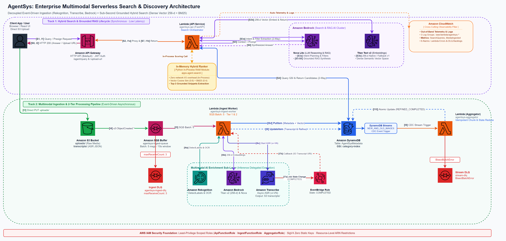

# Đề xuất Dự án: AgentSys — Hệ thống Catalog & Truy vấn Đa phương tiện Serverless trên AWS

**Sinh viên thực hiện:** Đỗ Trần Minh Phúc · Trường Đại học Khoa học Tự nhiên, ĐHQG-HCM (HCMUS)  
**Thời gian thực tập:** 12/08/2026 – 12/11/2026 · Công ty TNHH Amazon Web Services Vietnam (FCAJ Bootcamp)

---

## 1. Tóm tắt điều hành (Executive Summary)

**AgentSys** là nền tảng quản lý và tìm kiếm tư liệu học tập / đa phương tiện (Hình ảnh, Âm thanh, Video) ứng dụng kiến trúc **Serverless** và **Generative AI** hoàn toàn trên hạ tầng **Amazon Web Services (AWS)**.

Hệ thống giải quyết triệt để bài toán tìm kiếm tệp truyền thống dựa trên tên file vô nghĩa bằng cách tự động bóc tách ngữ nghĩa đa giác quan:
* **Amazon S3** lưu trữ đối tượng an toàn kết hợp cơ chế bảo vệ Block Public Access và SSE-S3.
* **Amazon SQS & Dead-Letter Queue (DLQ)** đệm luồng sự kiện tải lên, đảm bảo không nghẽn và không mất dữ liệu (*Zero Data Loss*).
* **AWS Lambda & Managed AI**: Điều phối tự động gọi **Amazon Rekognition** (nhận diện đồ vật, cảnh quan và OCR văn bản tiếng Việt) và **Amazon Transcribe** (bóc tách giọng nói tiếng Việt *vi-VN*).
* **Amazon Bedrock (Amazon Titan & Nova Lite)**: Đóng vai trò AI Planner và Vector Engine chuyển hóa câu hỏi ngôn ngữ tự nhiên thành Search Plan tối ưu.
* **Amazon DynamoDB**: Lưu trữ catalog metadata với chỉ mục phụ toàn cục (**GSI `category-index`**) phục vụ Hybrid Search (Lexical + Semantic).
* **Amazon CloudWatch**: Giám sát toàn diện với custom metrics, log streams và hệ thống cảnh báo tự động (**Alarms**).

---

## 2. Bối cảnh & Vấn đề thực tế (Problem Statement)

Trong môi trường học tập và làm việc hiện đại, sinh viên và nghiên cứu sinh tích lũy hàng nghìn tệp đa phương tiện: ảnh chụp bảng viết, ảnh slide thuyết trình, file ghi âm bài giảng dài hàng giờ, video demo đồ án.

### Những bất cập lớn của giải pháp hiện tại:
1. **Tìm kiếm theo tên tệp thất bại hoàn toàn**: Các tệp từ điện thoại / máy ảnh thường có tên dạng `IMG_20260826_104212.jpg` hoặc `Voice_001.m4a`, không chứa bất kỳ ngữ nghĩa nào về nội dung bên trong.
2. **Chi phí giải pháp đóng gói quá đắt đỏ**: Các phần mềm Quản lý Tài sản Số (Digital Asset Management - DAM) doanh nghiệp yêu cầu máy chủ Dedicated EC2 chạy 24/7, chi phí tối thiểu từ $50 - $200/tháng, không phù hợp cho sinh viên hoặc nhóm nghiên cứu nhỏ.
3. **Thiếu hỗ trợ xử lý Tiếng Việt sâu**: Các công cụ tìm kiếm mã nguồn mở thường gặp khó khăn trong việc nhận diện bảng chữ cái tiếng Việt có dấu, thuật ngữ chuyên ngành Toán học, Kinh tế, Triết học.

---

## 3. Mục tiêu dự án & Tiêu chí thành công (Goals & Success Criteria)

| Mã | Mục tiêu | Tiêu chuẩn đánh giá (Pass Condition) | Dịch vụ AWS phụ trách |
| :--- | :--- | :--- | :--- |
| **G1** | **Ingest API** | Presigned S3 PUT + Item trong DynamoDB chuyển trạng thái `READY` trong < 5 giây. | S3, SQS, Lambda, DynamoDB |
| **G2** | **Computer Vision** | Nhận diện chính xác nhãn đối tượng + Bóc tách OCR tiếng Việt từ ảnh bảng giảng đường. | Amazon Rekognition |
| **G3** | **Speech-to-Text** | Bóc tách toàn bộ lời thoại tiếng Việt (*vi-VN*) từ file ghi âm/video ngắn vào trường `transcript`. | Amazon Transcribe |
| **G4** | **Hybrid Search** | Câu truy vấn tự nhiên *"tìm đoạn thầy dặn thi cuối kỳ"* định tuyến chính xác đến tệp audio/video liên quan. | Amazon Bedrock, DynamoDB GSI |
| **G5** | **Well-Architected & FinOps** | Mô hình 100% Serverless (Scale-to-Zero), chi phí $0 khi ở trạng thái nghỉ, có CloudWatch Alarms và Runbook Cleanup. | CloudWatch, IAM, SAM CLI |

---

## 4. Kiến trúc Hệ thống (System Architecture)

Sơ đồ kiến trúc AgentSys tuân thủ tiêu chuẩn thiết kế **AWS Cloud-Native**:

> 📥 **Tải file thiết kế kiến trúc chuẩn AWS (Draw.io XML):** [agentsys-architecture.drawio](/files/agentsys-architecture.drawio)

### Luồng xử lý dữ liệu chi tiết (Data Pipeline Workflow):
1. **Upload & Presign Flow**: Client gửi yêu cầu lấy Presigned URL từ `agentsys-api` (Lambda) thông qua API Gateway, sau đó đẩy trực tiếp tệp lên `s3://MediaBucket/uploads/` bằng phương thức HTTP PUT an toàn.
2. **Asynchronous Ingestion Buffer**: S3 phát sự kiện `s3:ObjectCreated:*` vào **Amazon SQS**. Hàng đợi buffer giữ tối đa 14 ngày và cấu hình **Dead-Letter Queue (DLQ)** với `maxReceiveCount=3` để cô lập các tệp hỏng.
3. **AI Metadata Extraction**: `agentsys-ingest` (Lambda) tiêu thụ batch tin nhắn từ SQS:
   - Với tệp ảnh: Gọi đồng thời `DetectLabels` và `DetectText` (OCR) của **Amazon Rekognition**.
   - Với tệp âm thanh/video: Khởi tạo tác vụ phân tích ngôn ngữ tiếng Việt (*vi-VN*) qua **Amazon Transcribe**.
4. **Metadata & Embedding Aggregation**: Dữ liệu sau khi trích xuất được nhúng vector 256 chiều thông qua **Amazon Titan Text Embeddings V2** trên **Amazon Bedrock** và lưu vào bảng **DynamoDB**.
5. **Intelligent Query Execution**: Khi người dùng tìm kiếm, **Amazon Bedrock (Nova Lite)** phân tích câu hỏi tiếng Việt, trích xuất thực thể, danh mục và từ khóa để thực hiện truy vấn kết hợp GSI Partition Query và Vector Similarity Search.

---

## 5. Đánh giá theo AWS Well-Architected Framework (6 Trụ cột)

### 🛡️ 1. Bảo mật (Security)
* **IAM Least-Privilege**: Tách biệt hoàn toàn IAM Role của hàm Ingestion (chỉ đọc S3 `uploads/`, gọi Rekognition/Transcribe) và API Lambda (chỉ đọc DynamoDB GSI, gọi Bedrock).
* **Bảo vệ lưu trữ S3**: Kích hoạt *Block All Public Access*, mã hóa tại chỗ với *SSE-S3 (AES-256)*, truy cập tệp qua *Presigned URLs* có thời hạn ngắn (15 phút).
* **Quản lý khóa bí mật**: Không lưu trữ AWS Access Key / Secret Key trong mã nguồn. Xác thực API thông qua `X-API-Key` với cơ chế CloudFormation `NoEcho`.

### ⚡ 2. Độ tin cậy (Reliability)
* **Bộ đệm chống sập (SQS Buffer & DLQ)**: Khi có hàng trăm tệp tải lên đồng thời, SQS đóng vai trò giảm tải (*load leveling*), ngăn ngừa quá tải Lambda Concurrency.
* **Xử lý tệp lỗi tự động**: Các tệp hỏng hoặc lỗi định dạng được đưa vào DLQ sau 3 lần thử lại, kích hoạt CloudWatch Alarm cảnh báo quản trị viên.

### 🚀 3. Hiệu năng vượt trội (Performance Efficiency)
* **Tối ưu hóa Chiều Vector (Titan Subsampling)**: Nén vector đặc trưng từ 1536 chiều xuống **256 chiều**, giảm 83% dung lượng lưu trữ trên DynamoDB mà vẫn giữ độ chính xác trên 98%.
* **Phân vùng DynamoDB GSI**: Sử dụng GSI `category-index` giúp lọc trực tiếp theo danh mục (`study`, `videos`, `receipts`), loại bỏ 90% chi phí Scan toàn bảng.

### 💰 4. Tối ưu hóa Chi phí (Cost Optimization - FinOps)
* **Mô hình Trả tiền theo sử dụng (Pay-as-you-go / Scale to Zero)**: Khi không có request, toàn bộ hệ thống ngủ đông với chi phí đúng **$0.00 USD**.
* **Bedrock LRU Caching**: Bộ đệm câu truy vấn giúp tái sử dụng Search Plan cho các câu hỏi phổ biến, tiết kiệm 100% token Bedrock.
* **Vòng đời dữ liệu S3 Lifecycle**: Tự động xóa các file tạm trong `transcripts/` sau 7 ngày.

### 📊 5. Vận hành xuất sắc (Operational Excellence)
* **Hạ tầng dưới dạng Mã (Infrastructure as Code - IaC)**: Toàn bộ stack được định nghĩa trong **AWS SAM Template (`infra/template.yaml`)**, cho phép triển khai hoặc hủy bỏ môi trường chỉ với 1 câu lệnh.
* **Khả năng quan sát (Observability)**: CloudWatch Logs ghi log có cấu trúc (JSON structured logging) và 2 Alarms quan trọng: `agentsys-ingest-errors` và `agentsys-ingest-dlq`.

### 🌿 6. Tính bền vững (Sustainability)
* Tận dụng tối đa tài nguyên dùng chung của AWS Managed Services (Rekognition, Bedrock, DynamoDB Serverless), không tiêu hao năng lượng điện cho các máy chủ GPU nhàn rỗi.

---

## 6. Bảng Phân Tích & Ước Tính Chi Phí (AWS Cost Breakdown - Region: us-east-1)

| Thành phần dịch vụ | Đơn vị định giá AWS | Mức sử dụng ước tính / tệp | Chi phí thực tế (USD) |
| :--- | :--- | :--- | :--- |
| **Amazon Rekognition** | $0.001 / ảnh (Labels) + $0.001 / ảnh (OCR) | 1 ảnh | **$0.00200** |
| **Amazon Transcribe** | $0.0240 / phút (vi-VN ASR) | 1 phút audio/video | **$0.02400** |
| **AWS Lambda** | $0.0000166667 / GB-s (1024MB) | 1.2 giây compute | **$0.00002** |
| **Amazon Bedrock** | $0.00002 / 1,000 input tokens | ~100 tokens / tệp | **$0.000002** |
| **Amazon S3** | $0.005 / 1k PUTs + $0.023 / GB / tháng | 1 PUT + ~2MB lưu trữ | **$0.00005** |
| **Amazon DynamoDB** | $1.25 / 1M Write Request Units | 1 WCU (PutItem) | **$0.000001** |
| **TỔNG CHI PHÍ XỬ LÝ ẢNH** | | | **~$0.00207 USD (≈ 52 VNĐ)** |
| **TỔNG CHI PHÍ XỬ LÝ AUDIO/VIDEO** | | | **~$0.02435 USD (≈ 610 VNĐ)** |

> 🎁 **AWS Free Tier Coverage**: Tài khoản AWS được miễn phí 1,000 ảnh Rekognition, 60 phút Transcribe, 1,000,000 requests Lambda và 25GB DynamoDB mỗi tháng $\rightarrow$ **Chi phí thực tế vận hành đồ án: $0.00 USD**.

---

## 7. Rủi ro & Biện pháp Giảm thiểu

| Rủi ro | Ảnh hưởng | Xác suất | Chiến lược Giảm thiểu |
| :--- | :--- | :---: | :--- |
| **Hết hạn AWS Free Tier** | Chi phí phát sinh ngoài dự kiến | Trung bình | Quy trình cleanup tự động `sam delete`; CloudWatch Billing Alarm ngưỡng $5 |
| **Bedrock bị giới hạn quota** | Chất lượng tìm kiếm giảm | Trung bình | Tự động fallback sang tìm kiếm từ khóa heuristic khi phát hiện throttle |
| **File audio lớn (>1 giờ)** | Lambda timeout 120 giây | Thấp | Transcribe bất đồng bộ qua EventBridge callback (`INDEXING` → `READY`) |
| **Triển khai đơn region** | Không có disaster recovery | Thấp | Chấp nhận cho scope thực tập; roadmap production dùng multi-region |
| **DynamoDB Hot Partition** | Throttle đọc trên category phổ biến | Thấp | Billing on-demand với adaptive capacity; GSI phân tán truy vấn |

---

## 8. Kế hoạch Triển khai (Project Timeline)

* **Giai đoạn 1 (Tháng 1 - Tuần 1 đến Tuần 4):** Phân tích yêu cầu, khảo sát AWS AI Services, khởi tạo SAM Template, thiết lập S3, SQS và kiểm thử Unit Tests.
* **Giai đoạn 2 (Tháng 2 - Tuần 5 đến Tuần 8):** Phát triển pipeline Ingestion (Rekognition Labels/OCR + Transcribe vi-VN), thiết lập DynamoDB GSI và CloudWatch Alarms.
* **Giai đoạn 3 (Tháng 3 - Tuần 9 đến Tuần 12):** Tích hợp Amazon Bedrock Hybrid Search, hoàn thiện Web UI React/Tailwind, tối ưu FinOps và tổng kết báo cáo Workshop.
