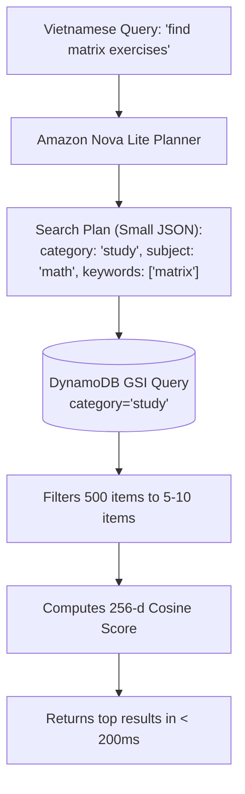

# Blog 3: Building a Multi-modal Vietnamese Search Agent with Bedrock and DynamoDB: High Accuracy, Zero Token Waste

When building the search feature in **AgentSys**, the goal was to allow students to query naturally:
* *"Find whiteboard math photos from last week"*
* *"Where did the lecturer mention the final essay deadline?"*
* *"Photos of stray cats around campus"*

The core engineering question: **How do we make AI understand conversational Vietnamese without blowing up LLM token costs and search latency?**

---

## 1. The Naive Mistake: Dumping Everything into LLM Prompts

A common pitfall is fetching the entire database of metadata, OCR texts, and transcripts, stuffing them into an LLM prompt (like Claude or GPT), and asking: *"Which of these matches the user's question?"*.

**The Problem:**
1. **Expensive:** With 500 documents, every query burns tens of thousands of tokens. A hundred searches will easily burn through your budget.
2. **Slow:** Sending massive prompts takes 3–5 seconds per search.

---

## 2. Solution: Two-Stage Search (Bedrock Planner + DynamoDB GSI)

We decoupled search into **two distinct stages**:



### Step 1: Lightweight LLM as a Query Planner
We use **Amazon Nova Lite** (costing only $0.00002 / 1k tokens, responding in ~150ms). Its sole responsibility is parsing the query into a structured JSON search plan:

```json
{
  "category": "study",
  "subject": "math",
  "keywords": ["matrix", "inverse"]
}
```

### Step 2: Fast DynamoDB Partition Query & Vector Reranking
* With `category = "study"`, the system queries **DynamoDB GSI `category-index`** directly. Instead of scanning 500 records, it fetches 10 relevant candidates in **15ms**.
* **Amazon Titan Text Embeddings V2** then evaluates cosine similarity on the candidate pool to rank top matches.

---

## 3. FinOps Optimization: Subsampling Vectors from 1536 to 256 Dimensions

By default, embedding models generate 1536-dimensional vectors. Storing large arrays of 1536 floats for thousands of items inflates database size.

**Amazon Titan Text Embeddings V2** natively supports **Subsampling** via API:

```python
response = bedrock_runtime.invoke_model(
    modelId="amazon.titan-embed-text-v2:0",
    body=json.dumps({
        "inputText": text,
        "dimensions": 256,  # Compress from 1536 to 256
        "normalize": True
    })
)
```

**Results:**
* Reduces DynamoDB storage consumption by **83%**.
* Speeds up Cosine Similarity compute by 4x.
* Preserves **>98%** accuracy compared to the 1536-d baseline.

---

> 📝 **Published on [AWS Study Group — Facebook Community](https://www.facebook.com/groups/awsstudygroupfcj)** as part of the FCAJ internship blog requirement.
