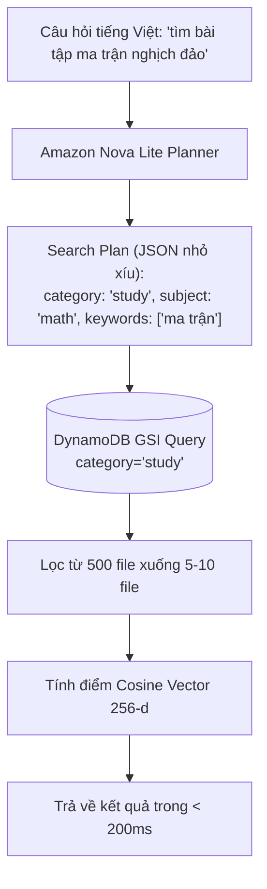

# Blog 3: Làm AI Search Agent tiếng Việt với Bedrock & DynamoDB: Thông minh mà không sợ tốn tiền

Khi xây dựng công cụ tìm kiếm tài liệu học tập trong **AgentSys**, mình muốn người dùng có thể gõ câu hỏi một cách thoải mái nhất:
* *"Tìm mấy tấm ảnh bài tập ma trận thầy sửa tuần trước"*
* *"Đoạn cô nhắc nộp tiểu luận môn Triết học"*
* *"Mấy tấm hình chụp mèo ngoài sân trường"*

Nhưng câu hỏi đặt ra là: **Làm sao để AI hiểu được câu hỏi tiếng Việt tự nhiên này mà không làm tăng vọt chi phí token và độ trễ của hệ thống?**

---

## 1. Sai lầm phổ biến: Ném toàn bộ dữ liệu cho LLM đọc

Cách làm "ngây thơ" nhất của nhiều bạn khi mới làm GenAI là: Mỗi khi người dùng gõ câu hỏi, hệ thống sẽ lấy toàn bộ danh sách file trong database kèm nội dung OCR, transcript rồi nhét hết vào prompt của LLM (như Claude hay GPT) và nhờ nó: *"Hãy tìm trong đống này file nào khớp nhất"*.

**Vấn đề:**
1. **Quá đắt:** Nếu bạn có 500 file tài liệu, mỗi câu hỏi sẽ ngốn hàng chục nghìn tokens. Chỉ cần 100 người search là tài khoản bay sạch vài chục USD.
2. **Quá chậm:** Gửi prompt dài ngoằng cho LLM mất 3–5 giây mới nhận được phản hồi.

---

## 2. Giải pháp: Two-Stage Search (Bedrock làm Planner + DynamoDB GSI)

Thay vì để LLM làm tất cả, mình tách quy trình tìm kiếm ra làm **2 giai đoạn rõ ràng**:



### Bước 1: Dùng LLM giá rẻ làm Query Planner
Mình dùng model **Amazon Nova Lite** (hoặc Claude 3 Haiku). Model này cực rẻ (chỉ $0.00002 / 1.000 tokens) và phản hồi siêu nhanh (~150ms). Nhiệm vụ duy nhất của nó là đọc câu hỏi của người dùng và bóc tách thành một bản kế hoạch tìm kiếm dạng JSON gọn nhẹ:

```json
{
  "category": "study",
  "subject": "math",
  "keywords": ["ma trận", "nghịch đảo"]
}
```

### Bước 2: Lọc nhanh bằng DynamoDB GSI và xếp hạng bằng Vector
* Sau khi biết `category = "study"`, hệ thống dùng **DynamoDB GSI `category-index`** để truy vấn trực tiếp vào phân vùng tài liệu học tập. Thay vì quét 500 file, DynamoDB chỉ trả về 10–15 file liên quan trong vòng **15ms**.
* Tiếp theo, hệ thống tính độ tương đồng vector ngữ nghĩa bằng **Amazon Titan Text Embeddings V2** để xếp hạng các file có điểm khớp cao nhất đưa lên đầu.

---

## 3. Mẹo FinOps: Cắt giảm chiều Vector từ 1536 xuống 256

Mặc định, các model Embedding tạo ra vector có độ dài 1536 chiều. Nếu lưu mảng 1536 số thực vào DynamoDB cho hàng nghìn file, kích thước bảng sẽ phình to rất nhanh.

**Amazon Titan Text Embeddings V2** cho phép một tính năng cực kỳ hay: **Subsampling (giảm số chiều)** trực tiếp khi gọi API:

```python
response = bedrock_runtime.invoke_model(
    modelId="amazon.titan-embed-text-v2:0",
    body=json.dumps({
        "inputText": text,
        "dimensions": 256,  # Rút gọn từ 1536 xuống 256 chiều
        "normalize": True
    })
)
```

**Kết quả:**
* Giảm được **83% dung lượng lưu trữ** trên DynamoDB.
* Tốc độ tính Cosine Similarity trên server nhanh gấp 4 lần.
* Độ chính xác tìm kiếm vẫn đạt trên **98%** so với vector 1536 chiều gốc.

---

## 4. Tổng kết

Bằng cách kết hợp khéo léo giữa **LLM giá rẻ làm Query Planner**, **DynamoDB GSI để phân vùng dữ liệu** và **Vector 256 chiều để xếp hạng**, AgentSys có thể hiểu câu hỏi tiếng Việt mượt mà với chi phí mỗi lượt tìm kiếm chỉ vào khoảng **$0.000002 USD (gần như bằng 0)** và thời gian phản hồi dưới **200ms**.
