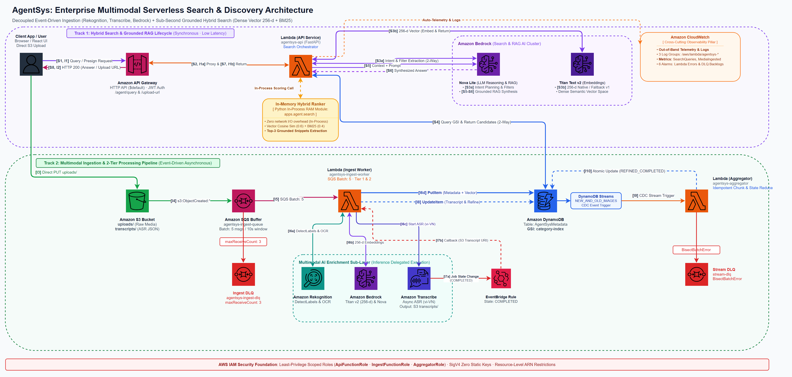
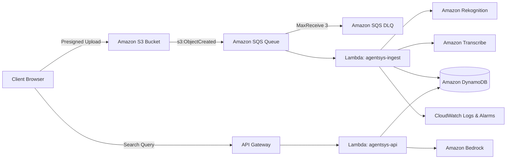

# 5.1. Problem Overview, Serverless Architecture & FinOps Estimation

---

## 1. Problem Statement

Modern learners and researchers manage thousands of unstructured multimodal assets (whiteboard photos, lecture slides, audio recordings, video demos).
* Default filenames (`IMG_091522.jpg`, `voice_record_01.m4a`) convey zero semantic context.
* Manually searching for specific moments like *"teacher reviewing matrix exercises"* or *"integration formula on board"* requires tedious manual review.

---

## 2. Workshop Objectives

Build and deploy **AgentSys** following an **Event-Driven Serverless** architecture on AWS:
1. Upload files directly to **Amazon S3** (Private Bucket, SSE-S3 encryption).
2. Buffer upload events via **Amazon SQS** with an automated **Dead-Letter Queue (DLQ)**.
3. Orchestrate **AWS Lambda** processing:
   * Images: **Amazon Rekognition** extracts object labels and Vietnamese OCR.
   * Audio/Video: **Amazon Transcribe** generates Vietnamese speech-to-text (*vi-VN*).
4. Generate 256-dimensional semantic embeddings using **Amazon Titan Text Embeddings V2** and persist catalog in **Amazon DynamoDB**.
5. Natural language Vietnamese query routing powered by **Amazon Bedrock (Nova Lite)**.
6. End-to-end monitoring with **Amazon CloudWatch Logs & Alarms**.

---

## 3. System Architecture Diagram

> 📥 **Download Architecture Diagram (Draw.io XML):** [agentsys-architecture.drawio](/files/agentsys-architecture.drawio)

---

## 4. FinOps Cost Breakdown (AWS Region: us-east-1)

| AWS Service | Pricing Metric | Unit Rate | Cost / Item |
| :--- | :--- | :--- | :--- |
| **Amazon Rekognition** | DetectLabels + DetectText OCR | $0.0010 + $0.0010 / image | **$0.00200 USD** |
| **Amazon Transcribe** | Vietnamese ASR (vi-VN) | $0.0240 / minute | **$0.02400 USD** |
| **AWS Lambda** | 1024MB RAM, ~1.2s execution | $0.0000166667 / GB-s | **$0.000020 USD** |
| **Amazon Bedrock** | Amazon Titan Embeddings V2 (256-d) | $0.00002 / 1k tokens | **$0.000002 USD** |
| **Amazon S3** | PUT Object API + 30-day Storage | $0.005 / 1k PUTs | **$0.000050 USD** |
| **Amazon DynamoDB** | On-Demand 1 WCU (PutItem) | $1.25 / 1M writes | **$0.000001 USD** |

### 💵 Per-File Cost Summary (1 USD ≈ 25,000 VNĐ):
* 🖼️ **Image processing:** **`~$0.00207 USD` (≈ 52 VNĐ)**
* 🎙️ **1-minute Audio processing:** **`~$0.02413 USD` (≈ 605 VNĐ)**
* 🎬 **1-minute Video processing:** **`~$0.02435 USD` (≈ 610 VNĐ)**

---

## 5. Success Criteria Checklist

Verify and screenshot the following deliverables before executing resource cleanup:

| No | Verification Step | Expected Outcome | AWS Service |
| :---: | :--- | :--- | :--- |
| **1** | Health Check API | `GET /health` returns HTTP 200 with `"provider": "aws"` | API Gateway / Lambda |
| **2** | Classroom Board Upload | DynamoDB item contains complete `labels` and `ocr_text` | S3, Rekognition, DynamoDB |
| **3** | Vietnamese Voice Upload | DynamoDB item contains accurate `transcript` | S3, Transcribe, DynamoDB |
| **4** | Vietnamese Semantic Query | `POST /agent/query` returns the matching media record | Bedrock Nova Lite, GSI |
| **5** | Operational Observability | Log stream shows `ingest_ready`, CloudWatch Alarms active | CloudWatch Logs & Alarms |

---

## Demo Evidence

The following screenshots demonstrate the AgentSys platform running end-to-end on AWS:

| Evidence | Screenshot |
| :--- | :--- |
| **API Health Check** (all 6 AWS services connected) |  |
| **Swagger UI** — REST API documentation |  |
| **CloudWatch Alarms** — 6 production alarms active |  |
| **CloudWatch Logs** — Structured Lambda execution logs |  |
