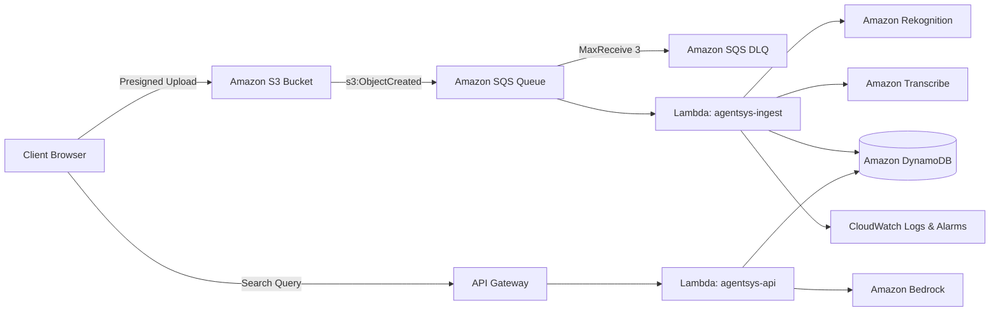

# 5.1. Tổng Quan Bài Toán, Kiến Trúc Serverless & Ước Tính FinOps

---

## 1. Bài toán thực tế (Problem Statement)

Người dùng (học sinh, sinh viên, kỹ sư) lưu trữ hàng nghìn hình ảnh bài giảng, ảnh chụp bảng viết tay, tệp ghi âm giọng nói dài và video đồ án trong thiết bị. 
* Tên file mặc định (`IMG_091522.jpg`, `voice_record_01.m4a`) không chứa bất kỳ ngữ nghĩa nào.
* Việc tìm lại nội dung như *"Đoạn thầy nhắc làm bài tập ma trận"* hay *"Công thức tính tích phân trên bảng"* thường mất hàng giờ xem lại thủ công.

---

## 2. Mục tiêu Workshop (Workshop Objectives)

Xây dựng hệ thống **AgentSys** xử lý tự động theo mô hình **Event-Driven Serverless**:
1. Upload tệp trực tiếp lên **Amazon S3** (Private Bucket, mã hóa SSE-S3).
2. Tự động đệm sự kiện qua **Amazon SQS** và **Dead-Letter Queue (DLQ)**.
3. **AWS Lambda** điều phối phân tích:
   * Ảnh: **Amazon Rekognition** trích xuất nhãn đối tượng + OCR văn bản tiếng Việt.
   * Âm thanh / Video: **Amazon Transcribe** bóc băng giọng nói tiếng Việt (*vi-VN*).
4. Nhúng vector 256 chiều qua **Amazon Titan Text Embeddings V2** và lưu catalog vào **Amazon DynamoDB**.
5. Nhận diện và trả lời câu hỏi tự nhiên tiếng Việt qua **Amazon Bedrock (Nova Lite)**.
6. Giám sát toàn diện qua **Amazon CloudWatch Logs & Alarms**.

---

## 3. Sơ đồ Kiến trúc Hệ thống (System Architecture)

> 📥 **Tải file thiết kế kiến trúc gốc (Draw.io XML):** [agentsys-architecture.drawio](/files/agentsys-architecture.drawio) (có thể mở và chỉnh sửa trực tiếp trên [app.diagrams.net](https://app.diagrams.net)).

---

## 4. Bảng Phân Rã Chi Phí & Tối Ưu Hóa FinOps (AWS Region: us-east-1)

Hệ thống được thiết kế theo nguyên lý **FinOps (Financial Operations)** nhằm tối ưu chi phí vận hành đến từng cent:

| Dịch vụ AWS | Hạng mục chi phí | Đơn giá AWS | Chi phí / Tệp |
| :--- | :--- | :--- | :--- |
| **Amazon Rekognition** | DetectLabels + DetectText OCR | $0.0010 + $0.0010 / ảnh | **$0.00200 USD** |
| **Amazon Transcribe** | Vietnamese ASR (vi-VN) | $0.0240 / phút | **$0.02400 USD** |
| **AWS Lambda** | 1024MB RAM, ~1.2s execution | $0.0000166667 / GB-s | **$0.000020 USD** |
| **Amazon Bedrock** | Amazon Titan Embeddings V2 (256-d) | $0.00002 / 1k tokens | **$0.000002 USD** |
| **Amazon S3** | PUT Object API + Storage 30 ngày | $0.005 / 1k PUTs | **$0.000050 USD** |
| **Amazon DynamoDB** | On-Demand 1 WCU (PutItem) | $1.25 / 1M writes | **$0.000001 USD** |

### 💵 Tổng kết quy đổi chi phí (Tỷ giá 1 USD ≈ 25,000 VNĐ):
* 🖼️ **Xử lý 1 ảnh:** **`~$0.00207 USD` (≈ 52 VNĐ)**
* 🎙️ **Xử lý 1 phút ghi âm:** **`~$0.02413 USD` (≈ 605 VNĐ)**
* 🎬 **Xử lý 1 phút video:** **`~$0.02435 USD` (≈ 610 VNĐ)**

---

## 5. Bảng Tiêu Chí Thành Công (Success Criteria Checklist)

Trước khi tiến hành dọn dẹp tài nguyên (Cleanup), bạn cần kiểm tra và chụp màn hình xác minh các tiêu chí sau:

| STT | Bài kiểm thử | Kết quả kỳ vọng | Dịch vụ kiểm tra |
| :---: | :--- | :--- | :--- |
| **1** | Health Check API | `GET /health` trả về HTTP 200, `"provider": "aws"` | API Gateway / Lambda |
| **2** | Upload ảnh giảng đường | Item trong DynamoDB có đầy đủ `labels` và `ocr_text` | S3, Rekognition, DynamoDB |
| **3** | Upload ghi âm tiếng Việt | Item trong DynamoDB có trường `transcript` chính xác | S3, Transcribe, DynamoDB |
| **4** | Truy vấn tiếng Việt | `POST /agent/query` tìm kiếm ngữ nghĩa ra đúng tệp | Bedrock Nova Lite, GSI |
| **5** | Giám sát vận hành | Log stream xuất hiện `ingest_ready`, CloudWatch Alarms sẵn sàng | CloudWatch Logs & Alarms |
