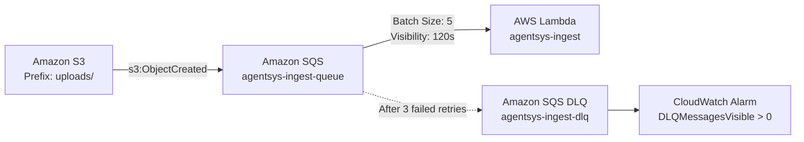

# 5.3. Configuring Amazon S3, SQS Buffer Queue, Dead-Letter Queue (DLQ) & Event Notifications

---

## 1. Storage Security Configuration on Amazon S3

In AgentSys, **Amazon S3** stores all raw media assets (images, audio, video) and generated transcription artifacts.

### Security Verification in the AWS Console:
1. Open the **Amazon S3 Console** $\rightarrow$ Select your bucket (`agentsys-mediabucket-...`).
2. **Permissions Tab**:
   * **Block all public access:** `ON` *(100% public data leak protection)*.
   * **Bucket Policy:** Grants `transcribe.amazonaws.com` read access on `uploads/` and write access on `transcripts/`.
3. **Properties Tab**:
   * **Default Encryption:** `Server-side encryption with Amazon S3 managed keys (SSE-S3)` (AES-256).
   * **Cross-origin resource sharing (CORS):** Enables Web Frontend (`http://localhost:5174` or production domain) to perform HTTP PUT uploads.

```json
[
  {
    "AllowedHeaders": ["*"],
    "AllowedMethods": ["GET", "PUT", "POST", "HEAD"],
    "AllowedOrigins": ["*"],
    "ExposeHeaders": ["ETag"]
  }
]
```

---

## 2. SQS Buffer & Dead-Letter Queue (DLQ) Architecture

Instead of binding S3 events directly to Lambda, AgentSys introduces **Amazon SQS** as a resilient buffer:



### Architectural Benefits:
1. **Traffic Spike Smoothing:** If a batch of 50 videos is uploaded concurrently, SQS absorbs the burst and feeds messages progressively to Lambda without exhausting concurrency.
2. **Zero Data Loss Isolation:** Damaged or corrupted media files are transferred to the DLQ after 3 retries (`maxReceiveCount=3`), allowing root-cause analysis without breaking pipeline throughput.

---

## 3. Recursive Event Loop Prevention

{}
**Crucial FinOps Rule:** Subscribing S3 Event Notifications to the entire bucket wildcard `s3:*` triggers an infinite recursion when Amazon Transcribe outputs a `.json` transcript $\rightarrow$ S3 emits an event $\rightarrow$ Lambda triggers Transcribe $\rightarrow$ Infinite billing loop!
{}

**Enforced Mitigation in AgentSys:**
* Ingestion events are strictly filtered to the prefix **`Prefix: uploads/`**.
* Transcribe outputs are strictly scoped to the prefix **`Prefix: transcripts/`**.

---

## 4. Testing Media Uploads via Presigned URL

```bash
# 1. Retrieve API Endpoint and API Key
API_ENDPOINT=$(aws cloudformation describe-stacks --stack-name agentsys --query "Stacks[0].Outputs[?OutputKey=='ApiEndpoint'].OutputValue" --output text)
API_KEY="your-secret-key-123"

# 2. Request a Presigned Upload URL
RESPONSE=$(curl -s -X POST "$API_ENDPOINT/api/v1/media/upload-url" \
  -H "X-API-Key: $API_KEY" \
  -H "Content-Type: application/json" \
  -d '{"filename": "test-board.jpg", "content_type": "image/jpeg"}')

UPLOAD_URL=$(echo $RESPONSE | jq -r '.upload_url')
FILE_ID=$(echo $RESPONSE | jq -r '.file_id')

echo "File ID: $FILE_ID"
echo "Presigned URL: $UPLOAD_URL"

# 3. Upload binary image via HTTP PUT
curl -X PUT -T "test-board.jpg" -H "Content-Type: image/jpeg" "$UPLOAD_URL"
```

*Upon successful PUT, S3 automatically forwards the notification to SQS, triggering the background Lambda ingestion.*
