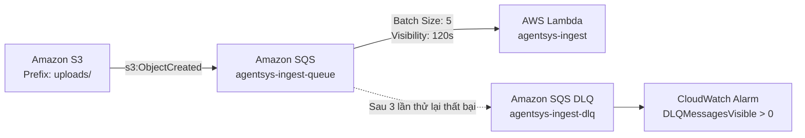

# 5.3. Thiết Lập Amazon S3, SQS Buffer Queue, Dead-Letter Queue (DLQ) & Event Notifications

---

## 1. Cấu hình Bảo mật Lưu trữ trên Amazon S3

Trong kiến trúc AgentSys, **Amazon S3** là nơi lưu trữ toàn bộ các tệp tư liệu gốc (ảnh, audio, video) và các tệp văn bản bóc băng kết quả.

### Xác minh các thiết lập bảo mật trên AWS Console:
1. Mở **Amazon S3 Console** $\rightarrow$ Chọn bucket vừa tạo (tên bắt đầu bằng `agentsys-mediabucket-...`).
2. Tab **Permissions (Quyền truy cập)**:
   * **Block all public access:** `ON` *(Ngăn chặn 100% việc lộ dữ liệu ra Internet công cộng)*.
   * **Bucket Policy:** Cho phép dịch vụ `transcribe.amazonaws.com` đọc dữ liệu từ `uploads/` và ghi kết quả vào `transcripts/`.
3. Tab **Properties (Thuộc tính)**:
   * **Default Encryption:** `Server-side encryption with Amazon S3 managed keys (SSE-S3)` mã hóa AES-256 tự động.
   * **Cross-origin resource sharing (CORS):** Cấu hình cho phép Web Frontend (`http://localhost:5174` hoặc domain production) gọi HTTP PUT để upload tệp.

```json
[
  {
    "AllowedHeaders": ["*"],
    "AllowedMethods": ["GET", "PUT", "POST", "HEAD"],
    "AllowedOrigins": ["*"],
    "ExposeHeaders": ["ETag"]
  }
]
```

---

## 2. Kiến trúc Hàng đợi Buffer SQS & Dead-Letter Queue (DLQ)

Thay vì kết nối trực tiếp sự kiện S3 vào Lambda, AgentSys sử dụng **Amazon SQS** làm tầng đệm:



### Tại sao kiến trúc này tối quan trọng?
1. **Chống sập do quá tải (Traffic Spike Smoothing):** Khi người dùng tải lên 50 video cùng lúc, SQS sẽ giữ các thông điệp và nhả dần theo từng đợt (batch) cho Lambda xử lý, không làm cạn kiệt Lambda Concurrent Executions.
2. **Cô lập lỗi (Zero Data Loss with DLQ):** Nếu tệp âm thanh bị lỗi hoặc hỏng codec, sau 3 lần retry (`maxReceiveCount=3`), tin nhắn được đẩy vào DLQ để kỹ sư kiểm tra mà không làm gián đoạn toàn bộ hệ thống.

---

## 3. Ngăn Chặn Vòng Lặp Sự Kiện Đệ Quy (Recursive Event Loop Prevention)

{}
**Quy tắc FinOps quan trọng:** Nếu cấu hình S3 Event Notification cho toàn bộ bucket `s3:*`, khi Amazon Transcribe tạo file kết quả `.json`, S3 sẽ lại phát sự kiện gọi Lambda $\rightarrow$ Lambda lại gọi Transcribe $\rightarrow$ Gây ra vòng lặp vô tận đốt cháy ngân sách!
{}

**Giải pháp trong AgentSys:**
* S3 Event Notification chỉ kích hoạt khi có tệp tạo mới với tiền tố **`Prefix: uploads/`**.
* Amazon Transcribe chỉ được phép ghi kết quả vào tiền tố **`Prefix: transcripts/`**.

---

## 4. Kiểm thử Upload Tệp Bằng Presigned URL Qua CLI

```bash
# 1. Lấy API Endpoint và API Key từ Stack
API_ENDPOINT=$(aws cloudformation describe-stacks --stack-name agentsys --query "Stacks[0].Outputs[?OutputKey=='ApiEndpoint'].OutputValue" --output text)
API_KEY="your-secret-key-123"

# 2. Yêu cầu cấp Presigned URL
RESPONSE=$(curl -s -X POST "$API_ENDPOINT/api/v1/media/upload-url" \
  -H "X-API-Key: $API_KEY" \
  -H "Content-Type: application/json" \
  -d '{"filename": "test-board.jpg", "content_type": "image/jpeg"}')

UPLOAD_URL=$(echo $RESPONSE | jq -r '.upload_url')
FILE_ID=$(echo $RESPONSE | jq -r '.file_id')

echo "File ID: $FILE_ID"
echo "Presigned URL: $UPLOAD_URL"

# 3. Đẩy tệp nhị phân lên S3 bằng HTTP PUT
curl -X PUT -T "test-board.jpg" -H "Content-Type: image/jpeg" "$UPLOAD_URL"
```

*Sau khi PUT thành công, S3 tự động phát sự kiện vào SQS và kích hoạt Lambda Ingest xử lý trong nền.*
