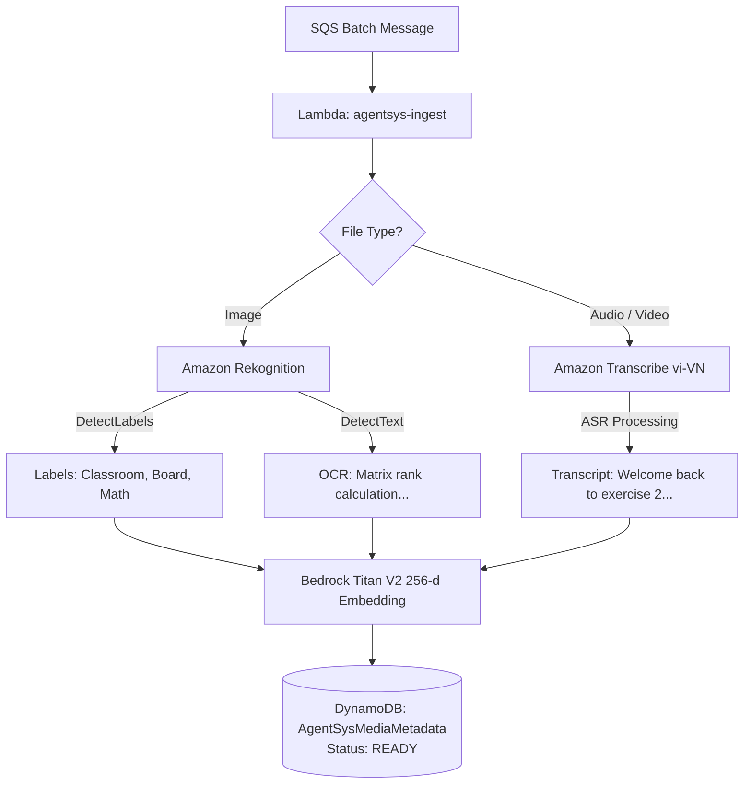

# 5.4. Deploying Lambda Ingestion Engine with Amazon Rekognition & Transcribe vi-VN

---

## 1. How the Lambda Ingest Function Operates

The **`agentsys-ingest`** Lambda function (located in `apps/lambda_handlers/ingest.py` and `apps/workers/ingestion.py`) acts as the central multi-modal orchestration engine:

1. **SQS Batch Ingestion**: Unwraps `s3:ObjectCreated` notification batches from SQS.
2. **MIME Type Inspection**: Automatically detects the media classification:
   * **Images (`.jpg`, `.png`, `.jpeg`, `.webp`)**: Dispatched to **Amazon Rekognition**.
   * **Audio & Video (`.mp3`, `.m4a`, `.wav`, `.mp4`)**: Dispatched to **Amazon Transcribe**.
3. **Metadata & Semantic Aggregation**:
   * Aggregates `labels`, `ocr_text`, `transcript`, file dimensions, and timestamps.
   * Invokes **Amazon Titan Text Embeddings V2** to compute a 256-dimensional vector embedding.
4. **DynamoDB Persistence**: Writes the consolidated record to `AgentSysMediaMetadata` with status `READY`.
5. **Operational Telemetry**: Publishes CloudWatch metrics `MediaIngested=1` or `MediaIngestFailed=1`.

---

## 2. Ingestion Processing Flowchart



---

## 3. Hands-on Lab: Classroom Image Ingestion & Verification

```bash
# 1. Upload sample classroom math board image
curl -s -X POST "$API_ENDPOINT/api/v1/media/upload" \
  -H "X-API-Key: $API_KEY" \
  -F "file=@sample_math_board.jpg"
```

### 2. Verify DynamoDB Metadata Record:
```bash
aws dynamodb get-item \
  --table-name AgentSysMediaMetadata \
  --key "{\"id\": {\"S\": \"<FILE_ID>\"}}" \
  --region us-east-1
```

**Expected JSON Output:**
```json
{
  "Item": {
    "id": {"S": "sample_math_board.jpg"},
    "status": {"S": "READY"},
    "category": {"S": "study"},
    "subject": {"S": "math"},
    "labels": {"SS": ["Classroom", "Whiteboard", "Text", "Equation"]},
    "ocr_text": {"S": "Exercise 2: Matrix rank discussion"},
    "summary": {"S": "Matrix algebra board notes with linear equation systems"}
  }
}
```

---

## 4. Hands-on Lab: Vietnamese Audio Ingestion & Verification

```bash
# 1. Upload sample lecture recording (.m4a / .mp3)
curl -s -X POST "$API_ENDPOINT/api/v1/media/upload" \
  -H "X-API-Key: $API_KEY" \
  -F "file=@lecture_philosophy.m4a"

# 2. Tail Lambda Ingestion Logs
sam logs -n IngestFunction --stack-name agentsys --tail
```

**Expected CloudWatch Log Output:**
```text
2026-08-26T11:00:00Z INFO [apps.workers.ingestion] Processing file: lecture_philosophy.m4a (type: audio)
2026-08-26T11:00:05Z INFO [apps.workers.ingestion] Transcribe job completed successfully. Extracted 420 words.
2026-08-26T11:00:06Z INFO [apps.workers.ingestion] Titan Embedding generated (256-d). Category: study, Subject: philosophy.
2026-08-26T11:00:07Z INFO [apps.workers.ingestion] ingest_ready: Item lecture_philosophy.m4a successfully saved to DynamoDB.
```
