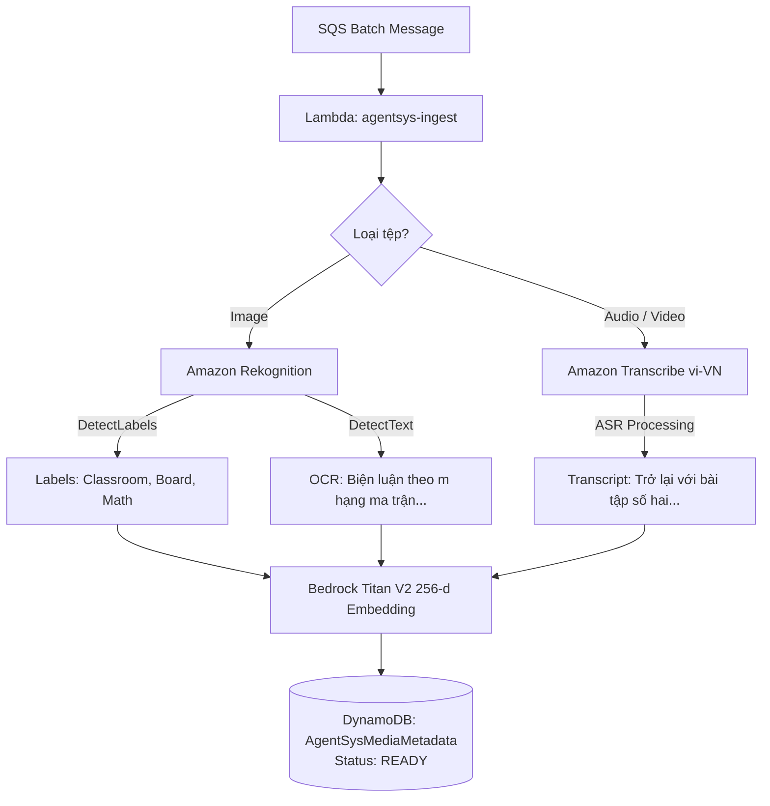

# 5.4. Triển Khai Lambda Ingestion Engine Với Amazon Rekognition & Transcribe vi-VN

---

## 1. Nguyên lý Hoạt động của Lambda Ingest Function

Hàm Lambda **`agentsys-ingest`** (mã nguồn: `apps/lambda_handlers/ingest.py` và `apps/workers/ingestion.py`) đóng vai trò là "Bộ não điều phối" (Orchestration Engine) xử lý đa phương tiện:

1. **Nhận Batch SQS**: Mở gói các bản ghi `s3:ObjectCreated` từ hàng đợi SQS.
2. **Phân loại Media Type**: Tự động nhận diện định dạng tệp thông qua extension và MIME type:
   * **Hình ảnh (`.jpg`, `.png`, `.jpeg`, `.webp`)**: Chuyển tiếp tới **Amazon Rekognition**.
   * **Âm thanh & Video (`.mp3`, `.m4a`, `.wav`, `.mp4`)**: Chuyển tiếp tới **Amazon Transcribe**.
3. **Trích xuất & Tổng hợp Siêu dữ liệu (Metadata Aggregation)**:
   * Tổng hợp `labels`, `ocr_text`, `transcript`, kích thước tệp và thời gian tạo.
   * Gọi **Amazon Titan Text Embeddings V2** tạo vector nhúng 256 chiều.
4. **Lưu trữ DynamoDB**: Ghi bản ghi vào bảng `AgentSysMediaMetadata` với trạng thái `READY`.
5. **Ghi nhận Metric Vận hành**: Phát custom metric `MediaIngested=1` hoặc `MediaIngestFailed=1` lên CloudWatch.

---

## 2. Luồng Xử Lý Chi Tiết Hình Ảnh & Giọng Nói



---

## 3. Thực Hành: Tải Lên và Xác Minh Tệp Ảnh Giảng Đường (Image Lab)

```bash
# 1. Tải lên tệp ảnh toán giảng đường
curl -s -X POST "$API_ENDPOINT/api/v1/media/upload" \
  -H "X-API-Key: $API_KEY" \
  -F "file=@sample_math_board.jpg"
```

### 2. Kiểm tra bản ghi trong Amazon DynamoDB:
```bash
aws dynamodb get-item \
  --table-name AgentSysMediaMetadata \
  --key "{\"id\": {\"S\": \"<FILE_ID>\"}}" \
  --region us-east-1
```

**Kết quả trả về chuẩn:**
```json
{
  "Item": {
    "id": {"S": "sample_math_board.jpg"},
    "status": {"S": "READY"},
    "category": {"S": "study"},
    "subject": {"S": "math"},
    "labels": {"SS": ["Classroom", "Whiteboard", "Text", "Equation"]},
    "ocr_text": {"S": "Bài tập 2: Biện luận theo m hạng của ma trận A"},
    "summary": {"S": "Hình ảnh bài tập toán ma trận và hệ phương trình tuyến tính"}
  }
}
```

---

## 4. Thực Hành: Tải Lên và Bóc Băng Tệp Âm Thanh Tiếng Việt (Audio Lab)

```bash
# 1. Tải lên tệp ghi âm bài giảng môn Triết (.m4a / .mp3)
curl -s -X POST "$API_ENDPOINT/api/v1/media/upload" \
  -H "X-API-Key: $API_KEY" \
  -F "file=@lecture_philosophy.m4a"

# 2. Theo dõi log Lambda Ingest theo thời gian thực
sam logs -n IngestFunction --stack-name agentsys --tail
```

**Log kỳ vọng xuất hiện trong CloudWatch:**
```text
2026-08-26T11:00:00Z INFO [apps.workers.ingestion] Processing file: lecture_philosophy.m4a (type: audio)
2026-08-26T11:00:05Z INFO [apps.workers.ingestion] Transcribe job completed successfully. Extracted 420 words.
2026-08-26T11:00:06Z INFO [apps.workers.ingestion] Titan Embedding generated (256-d). Category: study, Subject: philosophy.
2026-08-26T11:00:07Z INFO [apps.workers.ingestion] ingest_ready: Item lecture_philosophy.m4a successfully saved to DynamoDB.
```
