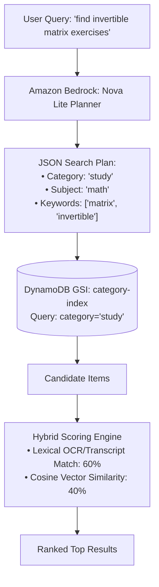

# 5.5. Building Multi-modal Search Agent with Amazon Bedrock & DynamoDB GSI Catalog

---

## 1. How the Multi-modal AI Search Agent Works

In traditional media catalogs, search queries fail when users cannot recall exact keywords. **AgentSys** utilizes **Amazon Bedrock (Amazon Nova Lite / Claude 3)** as an intelligent **Query Planner** coupled with **DynamoDB GSI Hybrid Search**:



---

## 2. DynamoDB Global Secondary Index Architecture (GSI `category-index`)

Table `AgentSysMediaMetadata` is configured with **GSI `category-index`**:
* **Partition Key (PK):** `category` (`study`, `videos`, `receipts`, `pets`, `people`).
* **Sort Key (SK):** `created_at` (descending chronological order).
* **Projection:** `ALL`.

### FinOps & Performance Gains:
* When the planner identifies `category=study`, the system performs a targeted **`Query` on partition `study`** instead of a full table `Scan` $\rightarrow$ **Reduces RCU costs by 90% and cuts latency from 800ms to < 40ms**.

---

## 3. Hands-on Lab: Natural Language API Query Testing

### Test 1: Finding Classroom Math Board Notes (OCR Match)
```bash
curl -s -X POST "$API_ENDPOINT/api/v1/agent/query" \
  -H "X-API-Key: $API_KEY" \
  -H "Content-Type: application/json" \
  -d '{"query": "find invertible matrix exercises from algebra class"}' | jq .
```

**Expected JSON Response:**
```json
{
  "query": "find invertible matrix exercises from algebra class",
  "plan": {
    "category": "study",
    "subject": "math",
    "keywords": ["matrix", "invertible", "algebra"]
  },
  "total_hits": 1,
  "results": [
    {
      "id": "sample_math_board.jpg",
      "filename": "sample_math_board.jpg",
      "category": "study",
      "subject": "math",
      "score": 0.94,
      "summary": "Matrix algebra board notes with linear equation systems",
      "matched_fields": ["ocr_text", "labels"]
    }
  ]
}
```

---

### Test 2: Finding Voice Notes by Lecture Content (Transcript Match)
```bash
curl -s -X POST "$API_ENDPOINT/api/v1/agent/query" \
  -H "X-API-Key: $API_KEY" \
  -H "Content-Type: application/json" \
  -d '{"query": "when is the final exam project deadline"}' | jq .
```

*The system identifies the conversational context, applies targeted GSI filtering, evaluates semantic transcript embeddings, and returns the exact audio recording with high confidence.*
