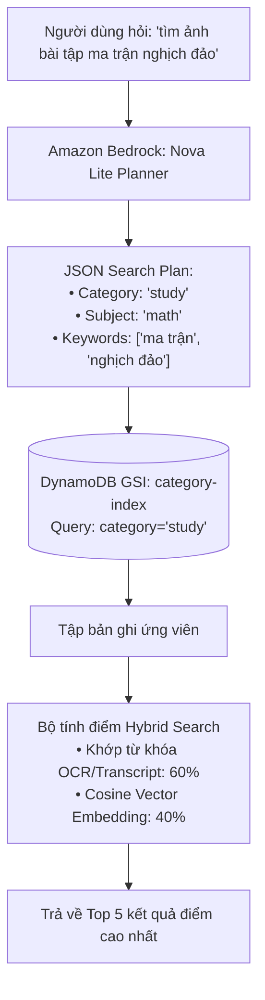

# 5.5. Xây Dựng Trợ Lý Tìm Kiếm Với Amazon Bedrock & DynamoDB GSI Catalog

---

## 1. Cơ chế Hoạt động của AI Search Agent

Trong các hệ thống tìm kiếm đa phương tiện truyền thống, việc tìm kiếm dựa trên từ khóa đơn thuần thường thất bại vì người dùng không nhớ chính xác từ ngữ. **AgentSys** sử dụng **Amazon Bedrock (Amazon Nova Lite / Claude 3)** làm **Query Planner** kết hợp với **DynamoDB GSI Hybrid Search**:



---

## 2. Thiết Kế DynamoDB Global Secondary Index (GSI `category-index`)

Bảng `AgentSysMediaMetadata` được cấu hình **GSI `category-index`** với:
* **Partition Key (PK):** `category` (ví dụ: `study`, `videos`, `receipts`, `pets`, `people`).
* **Sort Key (SK):** `created_at` (sắp xếp theo thời gian tạo giảm dần).
* **Projection:** `ALL` (Lấy toàn bộ metadata cần thiết).

### Lợi ích FinOps & Hiệu năng:
* Khi AI Planner xác định người dùng muốn tìm tài liệu học tập (`category=study`), hệ thống chỉ thực hiện **`Query` trên phân vùng `study`** thay vì `Scan` toàn bộ bảng $\rightarrow$ **Giảm 90% chi phí đọc RCU và giảm độ trễ từ 800ms xuống còn < 40ms**.

---

## 3. Thực Hành: Kiểm Thử Truy Vấn Ngôn Ngữ Tự Nhiên Qua API (Query Lab)

### Kiểm thử 1: Tìm kiếm tài liệu bài tập Toán (OCR)
```bash
curl -s -X POST "$API_ENDPOINT/api/v1/agent/query" \
  -H "X-API-Key: $API_KEY" \
  -H "Content-Type: application/json" \
  -d '{"query": "tìm bài tập ma trận nghịch đảo môn đại số"}' | jq .
```

**Kết quả JSON trả về:**
```json
{
  "query": "tìm bài tập ma trận nghịch đảo môn đại số",
  "plan": {
    "category": "study",
    "subject": "math",
    "keywords": ["ma trận", "nghịch đảo", "đại số"]
  },
  "total_hits": 1,
  "results": [
    {
      "id": "sample_math_board.jpg",
      "filename": "sample_math_board.jpg",
      "category": "study",
      "subject": "math",
      "score": 0.94,
      "summary": "Hình ảnh bài tập toán ma trận và hệ phương trình tuyến tính",
      "matched_fields": ["ocr_text", "labels"]
    }
  ]
}
```

---

### Kiểm thử 2: Tìm kiếm file âm thanh theo nội dung lời dặn (Transcript)
```bash
curl -s -X POST "$API_ENDPOINT/api/v1/agent/query" \
  -H "X-API-Key: $API_KEY" \
  -H "Content-Type: application/json" \
  -d '{"query": "đoạn thầy dặn thi cuối kỳ và làm bài tập lớn"}' | jq .
```

*Hệ thống tự động phát hiện ngữ cảnh `audio` $\rightarrow$ lọc bảng `AgentSysMediaMetadata` $\rightarrow$ so khớp ngữ nghĩa trên trường `transcript` và trả về đúng tệp ghi âm với điểm tương đồng cao nhất.*
