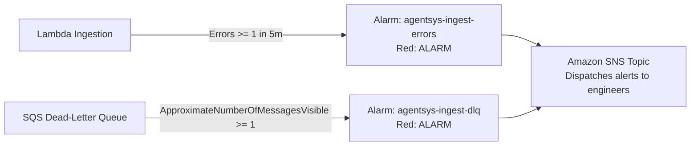

# 5.6. Setting up CloudWatch Monitoring, Alarms and Resource Cleanup Runbook

---

## 1. System Observability with Amazon CloudWatch

Under official **AWS First Cloud Journey (FCJ)** evaluation standards, cloud-native systems must demonstrate robust **Operational Excellence**:

### 1.1. Structured Logging
Lambda functions (`IngestFunction`, `ApiFunction`) emit structured JSON logs to **CloudWatch Logs**:
* Ingestion Log Group: `/aws/lambda/agentsys-ingest`
* API Log Group: `/aws/lambda/agentsys-api`

### 1.2. Custom CloudWatch Metrics
Custom operational telemetry is published directly to namespace **`AgentSys`**:
* **`MediaIngested`**: Count of successfully processed and indexed assets.
* **`MediaIngestFailed`**: Count of unrecoverable failed ingestion tasks.

---

## 2. Automated CloudWatch Alarms

The SAM Template provisions **2 core CloudWatch Alarms**:



### Alarm Verification in AWS Console:
1. Open the **Amazon CloudWatch Console** $\rightarrow$ Navigate to **Alarms** (Region: `us-east-1`).
2. Verify both alarms show a healthy green **`OK`** status:
   * `agentsys-ingest-errors`: Monitors Lambda runtime failure rates.
   * `agentsys-ingest-dlq`: Triggers immediately when items are relegated to the DLQ.

{}
**Report Deliverable:** Capture screenshots of your active CloudWatch Alarms in `OK` state and the Ingest Lambda Log stream for your internship submission.
{}

---

## 3. Resource Cleanup Runbook

To guarantee zero lingering costs following the workshop lab:

### Step 1: Empty the S3 Media Bucket
CloudFormation blocks stack deletion if an S3 bucket contains objects:

```bash
# Retrieve bucket name from CloudFormation Outputs
BUCKET_NAME=$(aws cloudformation describe-stacks --stack-name agentsys --query "Stacks[0].Outputs[?OutputKey=='MediaBucketName'].OutputValue" --output text)

# Recursively empty the bucket
aws s3 rm s3://$BUCKET_NAME --recursive
```

---

### Step 2: Delete CloudFormation Stack via SAM CLI
```bash
cd agent_sys
sam delete --stack-name agentsys --no-prompts --region us-east-1
```

*This command automatically deprovisions API Gateway, Lambda Functions, IAM Execution Roles, DynamoDB Table `AgentSysMediaMetadata`, SQS Queues, DLQs, and CloudWatch Alarms within 2 minutes.*

---

### Step 3: Verify 100% Resource Deprovisioning
```bash
aws cloudformation describe-stacks --stack-name agentsys --region us-east-1
```
*The response `Stack with id agentsys does not exist` confirms all cloud resources have been cleanly torn down, returning your monthly bill to **`$0.00 USD`**!* 🎉
