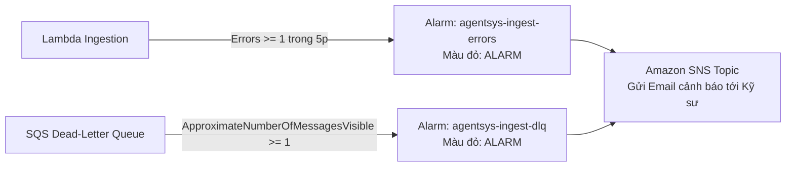

# 5.6. Thiết Lập CloudWatch Monitoring, Alarms và Quy Trình Dọn Dẹp Tài Nguyên (Cleanup)

---

## 1. Khả năng Quan sát Hệ thống (Observability with Amazon CloudWatch)

Trong quy chuẩn đánh giá của **AWS First Cloud Journey (FCJ)**, một kiến trúc Cloud chuẩn Production bắt buộc phải có khả năng giám sát vận hành (**Operational Excellence**):

### 1.1. Structured Logging (Ghi log có cấu trúc)
Tất cả các hàm Lambda (`IngestFunction`, `ApiFunction`) đều ghi log dưới dạng JSON có cấu trúc vào **CloudWatch Logs**:
* Log group Ingestion: `/aws/lambda/agentsys-ingest`
* Log group API: `/aws/lambda/agentsys-api`

### 1.2. Custom CloudWatch Metrics
Hệ thống tự động phát các chỉ số vận hành tùy biến (*Custom Metrics*) vào Namespace **`AgentSys`**:
* **`MediaIngested`**: Số lượng tệp đã xử lý và nhúng vector thành công.
* **`MediaIngestFailed`**: Số lượng tệp xử lý thất bại cần can thiệp.

---

## 2. Thiết lập Cảnh báo Tự động (CloudWatch Alarms)

SAM Template tự động cấu hình **2 CloudWatch Alarms** cốt lõi:



### Xác minh Alarms trên AWS Console:
1. Mở **Amazon CloudWatch Console** $\rightarrow$ Chọn mục **Alarms** (Region: `us-east-1`).
2. Xác minh 2 Alarms đang ở trạng thái màu xanh **`OK`**:
   * `agentsys-ingest-errors`: Cảnh báo khi Lambda gặp lỗi runtime.
   * `agentsys-ingest-dlq`: Cảnh báo khi có tệp bị đẩy vào Dead-Letter Queue.

{}
**Chụp ảnh báo cáo:** Chụp lại màn hình danh sách CloudWatch Alarms ở trạng thái `OK` và Log Group của Ingest Lambda để nộp vào báo cáo workshop.
{}

---

## 3. Quy trình Dọn dẹp Tài nguyên (Resource Cleanup Runbook)

Để đảm bảo tài khoản AWS của bạn không bao giờ phát sinh bất kỳ chi phí nào sau khi kết thúc buổi thực hành lab, hãy thực hiện theo đúng các bước sau:

### Bước 1: Xóa toàn bộ dữ liệu trong S3 Media Bucket
Do CloudFormation không thể xóa một S3 bucket còn chứa tệp, bạn cần dọn sạch bucket trước:

```bash
# Lấy tên Bucket từ CloudFormation Outputs
BUCKET_NAME=$(aws cloudformation describe-stacks --stack-name agentsys --query "Stacks[0].Outputs[?OutputKey=='MediaBucketName'].OutputValue" --output text)

# Xóa đệ quy toàn bộ tệp trong bucket
aws s3 rm s3://$BUCKET_NAME --recursive
```

---

### Bước 2: Xóa toàn bộ CloudFormation Stack bằng SAM CLI
```bash
cd agent_sys
sam delete --stack-name agentsys --no-prompts --region us-east-1
```

*Lệnh này sẽ tự động xóa sạch toàn bộ: API Gateway, các Lambda Functions, IAM Execution Roles, bảng DynamoDB `AgentSysMediaMetadata`, SQS Queues, DLQ và CloudWatch Alarms trong vòng 2 phút.*

---

### Bước 3: Xác minh trạng thái dọn dẹp sạch sẽ
```bash
aws cloudformation describe-stacks --stack-name agentsys --region us-east-1
```
*Kết quả thông báo `Stack with id agentsys does not exist` xác nhận toàn bộ tài nguyên đã được thu hồi hoàn toàn, chi phí về đúng **`$0.00 USD`**!* 🎉
